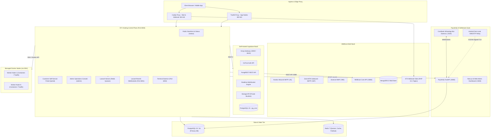

# STX Enterprises — Cloud Platform & Hosting Control Plane

<p align="center">
  <strong>Enterprise-Grade Cloud Infrastructure, Self-Service Client Portal, Multi-Vector AI Payment Verification & Self-Hosted BaaS / Mail Hosting</strong><br>
  <em>Engineered by STX Enterprises &middot; Digital Empire Studio</em>
</p>

<p align="center">
  <a href="#current-platform-status"></a>
  <a href="#technology-stack"></a>
  <a href="#technology-stack"></a>
  <a href="#technology-stack"></a>
  <a href="#technology-stack"></a>
  <a href="#technology-stack"></a>
  <a href="#technology-stack"></a>
</p>

---

## Table of Contents

- [Overview](#overview)
- [Current Platform Status](#current-platform-status)
- [Architecture Overview](#architecture-overview)
- [Core Capabilities](#core-capabilities)
- [Technology Stack](#technology-stack)
- [Project Directory Structure](#project-directory-structure)
- [Quick Start & Local Setup](#quick-start--local-setup)
- [Self-Hosted Production Stack](#self-hosted-production-stack)
- [Testing & Quality Assurance](#testing--quality-assurance)
- [Documentation Index](#documentation-index)
- [License & Support](#license--support)

---

## Overview

**STX Enterprises Cloud Platform** is an enterprise-grade cloud hosting and orchestration platform that unifies public customer acquisition, self-service Git and Docker container provisioning, managed standalone databases, self-hosted email hosting, containerized Supabase BaaS, multi-vector AI payment slip verification (PayVerify), and native real-time infrastructure telemetry into a cohesive control plane.

Built with **Laravel 12** (operating in the explicit Laravel 10 file structure), **Livewire 3**, and **Tailwind CSS v4**, the entire platform — including marketing storefront, client self-service portal, operations console, and 90-day status telemetry — runs natively in high-performance PHP on port `8000`.

---

## Current Platform Status

Every capability listed below is verified against the active codebase and configuration:

| Subsystem | Area | Status | Verification & Codebase Anchor |
|---|---|---|---|
| **Core PaaS** | 1-Click App Deployment | **DONE** | 31 curated production compose templates in `templates/compose/`; deployed via `DeployWizard.php` & `ApplicationDeploymentJob.php`. |
| **Core PaaS** | Multi-Node Management | **DONE** | Managed via SSH keys and remote Docker engine over SSH; non-root sudo parsing via `parseCommandsByLineForSudo()`. |
| **Core PaaS** | Domains & DNS Verification | **DONE** | Apex & subdomains managed via `CustomDomain.php`; DNS verified via `CustomDomainService.php` and `PollCustomDomainDnsJob.php`. |
| **Core PaaS** | Automated SSL / HTTPS | **DONE** | Traefik auto-SSL for deployed apps; Caddy automated TLS for mail and webmail endpoints (`docker/caddy/Caddyfile`). |
| **Backend BaaS** | Self-Hosted Supabase | **DONE** | Full stack in `docker/supabase/docker-compose.yml` (Kong, GoTrue, PostgREST, Realtime, Storage, Studio, PostgreSQL 15 + `pg_cron`). Configured via `config/supabase.php`. |
| **Backend BaaS** | Supabase RLS Policies | **DONE** | Granular Row Level Security policies across profiles, teams, orders, invoices, and storage in `supabase/migrations/20261115000007_rls_policies.sql`. |
| **Authentication** | Email & Password + Verification | **DONE** | Laravel Fortify registration, password hashing, and email verification links (`/email/verify/{id}/{hash}`). |
| **Authentication** | Two-Factor (TOTP) & Passkeys | **DONE** | Fortify TOTP authenticator app pairing and WebAuthn Passkeys (`ConfigurePasskeys.php`). |
| **Authentication** | Social OAuth Logins | **DONE** | Google, Discord, GitHub, Azure, Authentik, Clerk, Zitadel, OIDC via `bootstrap/helpers/socialite.php` and `OauthController.php`. |
| **Authentication** | Password Reset & Magic Links | **DONE** | Signed password reset tokens and passwordless magic links (`/auth/link`) with rate limiting. |
| **Mail System** | WildDuck Mail Server | **DONE** | Self-hosted WildDuck 1.55.2 stack with Haraka inbound SMTP (25), Zone-MTA outbound SMTP (587), Dovecot IMAP (993), and MongoDB 6. |
| **Mail System** | Mailbox & Domain Provisioning | **DONE** | Mailbox, domain, and alias provisioning via `WildDuckProvisioningService.php` with MX, SPF, DKIM, and DMARC verification. |
| **Mail System** | STX Webmail UI | **DONE** | Standalone lightweight PHP 8.3 / Nginx client in `webmail-ui/` with multi-account switching, new mail polling, and portal deep-links. |
| **Products & Commerce** | Template Catalog & Limits | **DONE** | `HostingProduct`, `HostingPlan`, `HostingLimit`, and `TemplateCatalogStudio.php` with cgroups resource boundaries. |
| **Products & Commerce** | Email Hosting Plans | **DONE** | Pooled storage plans (Starter 5GB, Basic 15GB, Pro 50GB, Business 100GB) + modular add-ons in `MailPlanStudio.php`. |
| **Products & Commerce** | VPS Fulfillment Workflow | **DONE** | Manual delivery workflow (`ProvisioningQueue.php`) with AES-256-GCM encrypted root credentials (`spatie/laravel-crypto`) and password confirmation reveal. |
| **Products & Commerce** | Invoicing & Renewals | **DONE** | Printable PDF invoices (`InvoicePdfService.php`), daily renewals 7 days prior (`GenerateRenewalInvoicesJob`), and 4-day grace suspensions (`ProcessOverdueSuspensionsJob`). |
| **Payments** | PayVerify AI Engine | **DONE** | Microservice suite in `payverify/` with Google Gemini 1.5 Flash multimodal vision (`gemini-1.5-flash`), local Ollama CPU fallback (`llama3.2-vision`), and fast dHash duplicate detection. |
| **Payments** | ComBank Statement Sync | **DONE** | Node.js WhatsApp Banking bot (`payverify-whatsapp-bot`) with 8-digit pairing code, ComBank state machine, and 60-second in-memory buffered OTP relay. |
| **Payments** | Android SMS Relay App | **DONE** | Native Kotlin/Compose app (`payverify-android`) with hardware-backed ECDSA P-256 signing and zero-leak in-memory OTP guarantees. |
| **Payments** | Verification Rules & Review | **DONE** | Auto-approval (>= 0.90 confidence or bank match), hard reject (< 0.60 or duplicate), manual review workbench (`/admin/billing/proofs`) with pessimistic row locking (`lockForUpdate()`). |
| **GitHub App** | Repository Deployments | **DONE** | Public and private repo builds via GitHub App (`bootstrap/helpers/github.php`, `GithubApp.php`) with webhook deployment triggers. |
| **Dashboards** | Customer Portal | **DONE** | Unified portal at `/portal` (Deploy wizard, app list, mail dashboard, custom domains, database restores, volume backups, billing). |
| **Dashboards** | Operations & Admin Studio | **DONE** | Administrative operations at `/admin` (Provisioning queue, proof review, template studio, mail plan studio, status studio). |
| **Dashboards** | Public Status Page | **DONE** | Public status at `/status` with 90-day uptime heatmap, masked host node telemetry, and subscriber email incident notifications. |
| **Cloud Automation** | Automated VPS API Provisioning | **IN PROGRESS** | Provider API clients exist (Hetzner, DigitalOcean, Vultr, Hostinger); commercial flow currently uses manual review while automated cloud quotas are hardened. |
| **Payment Gateways** | Direct Card / Stripe Webhooks | **IN PROGRESS** | Stripe webhook function exists (`supabase/functions/stripe-webhook`); manual bank transfer verification remains primary active flow. |
| **Architecture** | Upstream Coolify v5 Split | **PLANNED** | Architectural design and ADRs in `docs/v5/` exploring flux connection broker and coold agent boundaries. |

---

## Architecture Overview



---

## Core Capabilities

### 1. Customer Self-Service Portal (`/portal`)
- **1-Click Deployments**: Deploy public/private Git repositories and 31 curated production compose templates with automatic Let's Encrypt SSL.
- **Standalone Databases**: Launch PostgreSQL 16, MySQL 8.4 LTS, and Redis 7.4 with isolated resources.
- **Multi-Target Database Restores**: Restore backups directly into running containers, into newly spawned standalone databases, or into custom target schemas.
- **Volume Backups**: Schedule persistent Docker volume backups to local disks or Cloudflare R2 / AWS S3.
- **Custom Domains & SSL**: Live DNS status verification and automated Traefik/Caddy certificate issuance.

### 2. Multi-Vector Payment Verification (PayVerify)
- **Fast Multimodal Vision AI**: Google Gemini 1.5 Flash vision extracts transaction amounts, references, dates, and receiving bank accounts. Local CPU fallback via Ollama (`llama3.2-vision`).
- **Forensic Protections**: Fast perceptual dHash duplicate check (`distance <= 5`) prevents re-use of slips; pure-pixel raster sanitization strips polyglot webshells.
- **ComBank WhatsApp Banking Daemon**: `@whiskeysockets/baileys` bot synchronizes statements from Commercial Bank of Ceylon (`+94 77 123 4567`) with 8-digit pairing codes and a 60-second in-memory buffered OTP relay.
- **Zero-Leak Android Interceptor**: Dedicated Kotlin/Compose mobile app relays bank SMS and OTPs in-memory over TLS with hardware-backed ECDSA P-256 signatures; OTPs are never written to disk or logs.
- **Staff Review Workbench (`/admin/billing/proofs`)**: Side-by-side zoomable visual diff with pessimistic row locking (`lockForUpdate()`).

### 3. Managed Email Hosting & STX Webmail UI (`/portal/mail`)
- **Complete Mail Stack**: Powered by WildDuck API, Haraka SMTP, Zone-MTA outbound engine, Dovecot IMAP, and MongoDB 6.
- **Sellable Pooled Storage Plans**: Starter (5 GB), Basic (15 GB), Pro (50 GB), Business (100 GB) with modular mailbox, domain, and storage add-ons.
- **DNS Record Verification**: Instant status badges for MX, SPF, DKIM (`s1` selector), and DMARC records.
- **STX Webmail UI (`webmail-ui`)**: Dependency-free PHP 8.3 / Nginx webmail client supporting up to 5 simultaneous accounts in one session, real-time unread notifications, and portal deep-links.

### 4. Self-Hosted Supabase BaaS
- **Containerized Stack**: Complete stack with Kong API Gateway, GoTrue Auth, PostgREST, Realtime WebSocket engine, Storage API, Studio UI, and PostgreSQL 15 with `pg_cron`.
- **Row Level Security (RLS)**: Enforces granular multi-tenant isolation across profiles, teams, orders, invoices, and storage buckets.
- **Native SDK Integration**: Built-in `SupabaseClient`, `SupabaseQueryBuilder`, and `SupabaseAuthService` bridging Laravel with Supabase APIs.

---

## Technology Stack

| Layer | Technologies |
|---|---|
| **Control Plane** | Laravel 12 (Laravel 10 structure), PHP 8.4, Livewire 3, Alpine.js, Tailwind CSS v4 |
| **Relational Database** | PostgreSQL 15 / 16 with UUID (CUID2) primary keys |
| **In-Memory Store & Queues**| Redis 7, Laravel Horizon (supervisor queues) |
| **WebSockets & Realtime** | Laravel Reverb (port 6001), Node.js Terminal daemon (port 6002) |
| **Self-Hosted BaaS** | Supabase (Kong, GoTrue, PostgREST, Realtime, Storage, Studio, Postgres 15 + pg_cron) |
| **Mail Infrastructure** | WildDuck 1.55.2, Haraka, Zone-MTA, Dovecot, MongoDB 6.0, Caddy 2.8 |
| **Webmail Client** | STX Webmail UI (`webmail-ui`): Native PHP 8.3-FPM, Nginx |
| **PayVerify Suite** | Python 3.11, FastAPI, Next.js 16 (React 19), Node.js (Baileys), Kotlin (Android SDK 34) |
| **Ingress & Proxying** | Traefik (application nodes), Caddy (mail & webmail TLS) |
| **Offsite Backups** | Cloudflare R2, Amazon S3 (encrypted volumes & database dumps) |

---

## Project Directory Structure

```text
stx-hosting/
├── app/                         # Core Laravel 12 Application (Laravel 10 structure)
│   ├── Actions/                 # Laravel Actions (Application, Database, Docker, Server, Commerce)
│   ├── Enums/                   # PHP Enums (Role, EntitlementStatus, ProductType, LimitType)
│   ├── Http/Controllers/        # REST API (/api/v1/) and Storefront controllers
│   ├── Jobs/                    # Queue jobs (ApplicationDeploymentJob, VerifyPaymentProofJob, etc.)
│   ├── Livewire/                # Livewire 3 components (Portal, Admin, Storefront, Status)
│   ├── Models/                  # Eloquent models (Server, Application, Commerce/*)
│   ├── Rules/                   # Validation rules (ValidGitRepositoryUrl, ValidServerIp, etc.)
│   └── Services/                # Business logic services (Commerce, Supabase, Backups, Rbac)
├── bootstrap/                   # Application bootstrap and global helper scripts
│   └── helpers/                 # shared.php, services.php, socialite.php, proxy.php, etc.
├── config/                      # Application configuration (commerce, supabase, hosting, etc.)
├── docker/                      # Docker configurations for self-hosted subsystems
│   ├── caddy/                   # Caddy reverse proxy for automated mail/webmail TLS
│   ├── mail/                    # WildDuck, Haraka, Zone-MTA, Dovecot, MongoDB stack
│   ├── supabase/                # Kong API gateway, configuration, and Supabase stack
│   └── webmail/                 # STX Webmail UI containerization
├── docs/                        # Complete technical documentation suite
├── payverify/                   # PayVerify Multi-Vector Payment Verification Platform
│   ├── payverify/               # Core Python FastAPI reconciliation & AI vision engine
│   ├── payverify-android/       # Native Kotlin/Compose zero-leak SMS/OTP interceptor app
│   ├── payverify-web/           # Next.js 16 Web Admin dashboard (monochrome glassmorphism)
│   ├── payverify-whatsapp-bot/  # ComBank WhatsApp Banking bot daemon (Baileys)
│   └── deploy/                  # Docker Compose production stack for PayVerify
├── public/                      # Public web assets, compiled Vite bundles, SVG icons
├── resources/                   # Blade templates, CSS (Tailwind v4), JavaScript
├── routes/                      # Route definitions (web.php, api.php, ai.php, channels.php)
├── scripts/                     # Operational scripts (dev multi-instance, upgrade.sh)
├── supabase/                    # Supabase migrations, RLS policies, seeds, and edge functions
├── templates/                   # Curated application deployment templates
│   ├── compose/                 # 31 active production compose templates
│   └── not-used/                # Archived legacy templates
├── tests/                       # Automated test suites (Pest 4, PHPUnit 11, Browser tests)
├── webmail-ui/                  # Standalone PHP 8.3 / Nginx WildDuck webmail client
├── .env.example                 # Comprehensive environment configuration template
├── docker-compose.selfhosted.yml# Master unified self-hosted Docker Compose stack
├── AGENTS.md                    # Developer and AI agent operating manual
└── README.md                    # This document
```

---

## Quick Start & Local Setup

### Prerequisites
- **PHP 8.2+** with extensions: `pdo_pgsql`, `redis`, `gd`, `curl`, `mbstring`, `fileinfo`
- **Composer 2.x**
- **Node.js 20+** & **npm**
- **Docker Engine & Docker Compose v2**

### Local CLI Setup
```bash
# 1. Clone repository & install dependencies
git clone https://github.com/your-org/stx-hosting.git
cd stx-hosting
composer install
npm install
npm run build

# 2. Configure environment
cp .env.example .env
php artisan key:generate

# 3. Run database migrations and seed default data
php artisan migrate --seed
php artisan db:seed --class=HostingCatalogSeeder
php artisan db:seed --class=NativeStatusMonitorSeeder

# 4. Start local development server
php artisan serve --port=8000
```

### Accessing Platform Endpoints (All on Port 8000)
- **Public Storefront**: `http://localhost:8000`
- **Public Status Telemetry**: `http://localhost:8000/status`
- **Customer Self-Service Portal**: `http://localhost:8000/portal`
- **Application Deploy Wizard**: `http://localhost:8000/portal/deploy`
- **Email Hosting Dashboard**: `http://localhost:8000/portal/mail`
- **Admin Provisioning Operations**: `http://localhost:8000/admin/operations/provisioning`
- **Payment Verification Queue**: `http://localhost:8000/admin/billing/proofs`
- **Template Catalog Studio**: `http://localhost:8000/admin/commerce/templates`
- **Mail Plan Studio**: `http://localhost:8000/admin/commerce/mail`
- **Laravel Horizon Dashboard**: `http://localhost:8000/horizon` (Root account only)

---

## Self-Hosted Production Stack

For a complete self-hosted deployment running STX Hosting, Supabase BaaS, WildDuck Mail, STX Webmail, and Caddy TLS:

```bash
# 1. Copy self-hosted environment files
cp .env.selfhosted.example .env
cp .env.supabase.example .env.supabase

# 2. Configure domain and secure passwords in .env
nano .env

# 3. Launch the master unified stack
docker compose -f docker-compose.selfhosted.yml up -d
```

---

## Testing & Quality Assurance

```bash
# Run all Pest tests
php artisan test --compact

# Run specific feature test suites
php artisan test --compact tests/Feature/Commerce/
php artisan test --compact tests/Feature/Hosting/
php artisan test --compact tests/Feature/Supabase/SupabaseIntegrationTest.php
php artisan test --compact tests/Feature/UpstreamSyncAndAdaptationTest.php
php artisan test --compact tests/Feature/DockerComposeInjectionCompatibilityTest.php

# Run Browser tests (headless Chromium via Playwright)
php artisan test --compact tests/v4/Browser/

# Code formatting (Laravel Pint)
vendor/bin/pint --dirty --format agent
```

---

## Documentation Index

Comprehensive guides for human developers and AI coding agents are located in [`docs/`](docs/):

- [Platform Architecture Reference](docs/architecture.md) — Topology, port allocations, and data flow diagrams.
- [Database Schema & RLS Policies](docs/database-schema-and-rls.md) — Models, CUID2 UUIDs, multi-tenant scoping, and Supabase RLS.
- [Authentication & Authorization Flows](docs/auth-flows.md) — Email/password, 2FA, Passkeys, OAuth, and Supabase GoTrue.
- [Domains, DNS & Automated SSL](docs/domains-dns-ssl.md) — Custom domains, DNS verification, Traefik and Caddy auto-SSL.
- [Multi-Node Server Management](docs/node-management.md) — SSH orchestration, remote Docker, telemetry probers, and server transfer.
- [Mail System & STX Webmail](docs/mail-system.md) — WildDuck email stack, pooled storage plans, and `webmail-ui`.
- [Payments & PayVerify AI Verification](docs/payments-flow.md) — Deposit slips, Gemini vision AI, WhatsApp bot, Android relay, and review queue.
- [GitHub App Integration](docs/github-integration.md) — Public and private repository deployments with webhooks.
- [API Reference & Developer Guide](docs/api-reference.md) — REST API (`/api/v1/`) and PayVerify External API (`/api/v1/external/`).
- [Deployment & Operational Runbook](docs/deployment-operations.md) — Docker Compose production setup, multi-target restores, upgrades.
- [Troubleshooting & Known Gotchas](docs/troubleshooting.md) — Pest browser test gotchas, Horizon, SSL, and PayVerify diagnostic runbooks.
- [AI Coding Agent Guidelines](AGENTS.md) — Mandatory invariants, coding conventions, and security rules for AI agents.

---

## License & Support

Copyright &copy; 2026 **STX Enterprises (Pvt) Ltd** &middot; **Digital Empire Studio**. All rights reserved.  
Unauthorized copying, reverse engineering, or redistribution of proprietary commerce modules, billing queues, or internal orchestrators is strictly prohibited.
