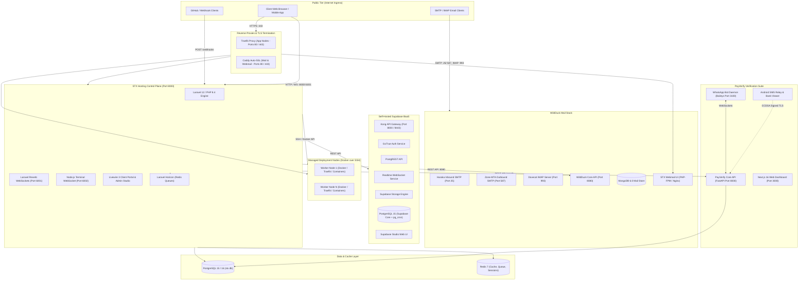
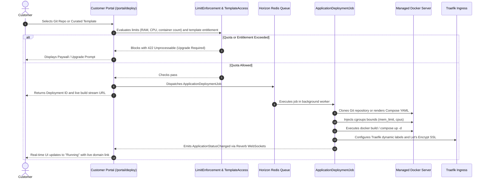
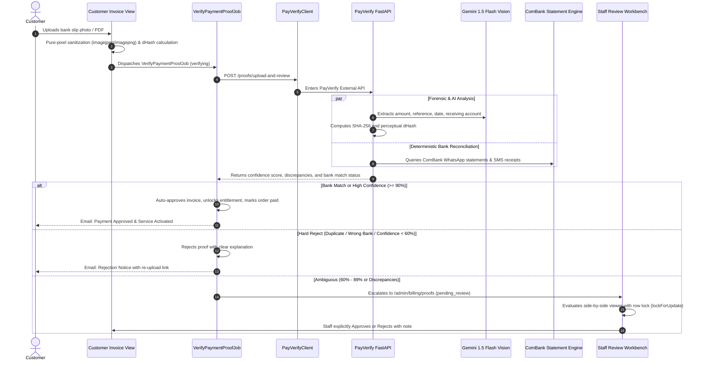

# STX Enterprises Cloud Platform Architecture Reference

## Overview

STX Enterprises Cloud Platform is an enterprise-grade cloud hosting and orchestration control plane built on **Laravel 12** (operating in the explicit Laravel 10 structure), **PHP 8.2+ / 8.4**, **Livewire 3**, and **Tailwind CSS v4**.

The platform provides a unified control plane uniting:
1. **Public Storefront & Telemetry**: Marketing, catalog, pricing, documentation, and a native 90-day status telemetry engine running on port `8000`.
2. **Customer Self-Service Portal (`/portal`)**: 1-click Git and Docker deployments, 31 curated application templates, managed standalone databases, domain management, multi-target database restores, volume backups, and email hosting.
3. **Administrative Operations Console (`/admin`)**: Manual multi-provider VPS fulfillment, side-by-side bank transfer verification queue, template catalog curation, mail plan configuration, and hypervisor health monitoring.
4. **Self-Hosted BaaS & Mail Stack**: Integrated containerized Supabase (Kong, GoTrue, PostgREST, Realtime, Storage, Studio) and WildDuck Mail (Haraka, Zone-MTA, Dovecot, MongoDB) with the containerized STX Webmail client.
5. **Multi-Vector Payment Verification (PayVerify)**: Microservice suite featuring Google Gemini 1.5 Flash multimodal vision, ComBank WhatsApp statement synchronization, and zero-leak Android OTP relay.

---

## Architectural Topology Diagram

---

## Subsystem Details & Port Allocations

| Subsystem | Service Name | Internal Port | External Port | Protocol | Purpose |
|---|---|---|---|---|---|
| **Control Plane** | `stx` | `8000` | `8000` | HTTP | Main Laravel 12 application, Storefront, Portal, Admin |
| **Broadcasting** | `reverb` | `6001` | `6001` | WebSocket | Real-time live status updates, notifications, chat |
| **Terminal Daemon** | `terminal` | `6002` | `6002` | WebSocket | Interactive SSH and container xterm shell sessions |
| **Database** | `postgres` | `5432` | `5432` | TCP | Primary platform relational data store (PostgreSQL 15/16) |
| **Cache & Queues** | `redis` | `6379` | `6379` | TCP | Redis cache, rate limiting, and Horizon job queue broker |
| **App Reverse Proxy** | `traefik` | `80`, `443` | `80`, `443` | HTTP/HTTPS | Ingress routing and Let's Encrypt certificates for apps |
| **Mail Edge Proxy** | `caddy` | `80`, `443` | `80`, `443` | HTTP/HTTPS | Automated ACME TLS reverse proxy for mail & webmail |
| **Supabase Kong** | `supabase-kong` | `8000`, `8443` | `8443` | HTTP/HTTPS | API gateway for Supabase REST, Auth, and Storage |
| **Supabase Auth** | `supabase-auth` | `9999` | Internal | HTTP | GoTrue authentication service |
| **Supabase Studio**| `supabase-studio`| `3000` | Internal | HTTP | Web SQL studio and table manager |
| **WildDuck API** | `wildduck` | `8080` | Internal | HTTP | Mail server management API |
| **Haraka SMTP** | `haraka` | `25` | `25` | SMTP | Inbound mail receiving agent |
| **Zone-MTA** | `zonemta` | `587` | `587` | SMTP | Outbound authenticated mail delivery agent |
| **Dovecot IMAP** | `dovecot` | `993` | `993` | IMAPS | Secure IMAP mail retrieval server |
| **Webmail Client** | `webmail` | `80` | Port via Caddy | HTTP | Lightweight PHP 8.3 / Nginx webmail UI |
| **PayVerify API** | `payverify-api` | `8000` | `8088` (or routed) | HTTP | FastAPI verification API and receipt extraction |
| **WhatsApp Daemon** | `whatsapp-bot` | `3100` | `3100` | HTTP | Baileys multi-device statement sync daemon |

---

## Data Flow Sequences

### 1. Application Deployment Flow

### 2. Multi-Vector Payment Verification Flow

---

## Architectural Invariants & Security Boundaries

1. **Root Team Sentinel (`team_id === 0`)**: The instance itself and global administrators operate under team ID `0`. All client teams have IDs `> 0`.
2. **Customer Resource Isolation**: Customers never receive SSH access to shared control plane nodes. VPS hosting is provided as isolated remote instances; application hosting is sandboxed within Docker containers with cgroups resource boundaries.
3. **Pessimistic State Transitions**: All payment decisions, order transitions, and quota claims must acquire a row-level pessimistic database lock (`lockForUpdate()`) to eliminate dual-admin or race conditions.
4. **Pure-Pixel Proof Sanitization**: All uploaded bank receipts are decoded and re-encoded using server-side graphics libraries (`imagejpeg`/`imagepng`), stripping embedded polyglot webshells and EXIF exploits.
5. **Zero-Leak OTP Policy**: ComBank two-factor authentication codes intercepted from mobile devices are held strictly in transient server memory with a 60-second TTL. They are never written to disk, SQLite, PostgreSQL, or persistent log sinks.
