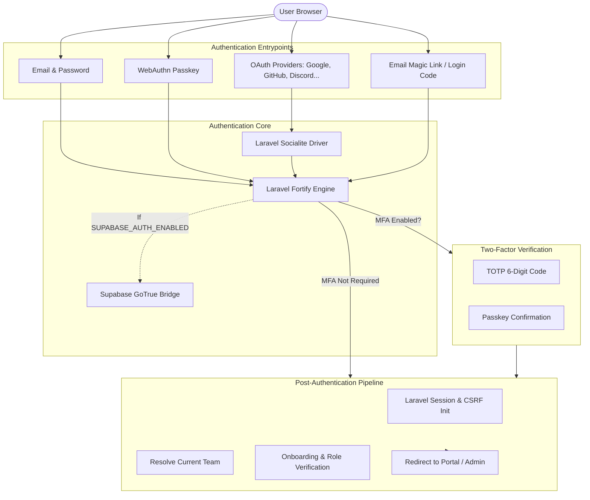
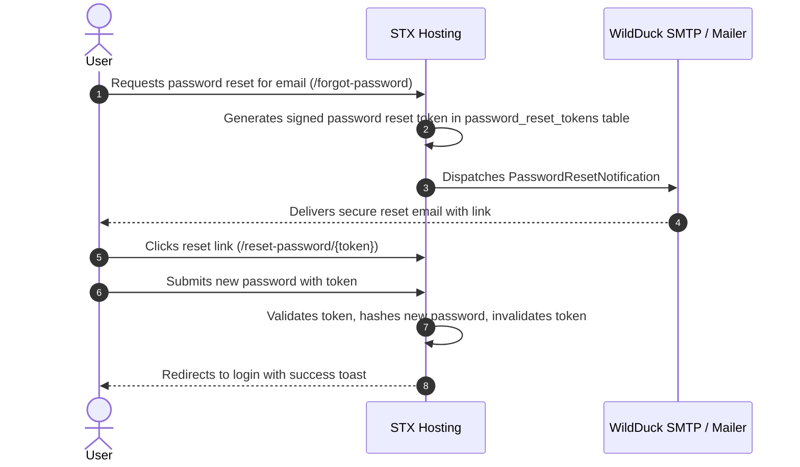

# Authentication & Authorization Flows

## Overview

STX Enterprises Cloud Platform supports a dual authentication architecture:
1. **Primary Control Plane Auth**: Powered by **Laravel Fortify** and **Laravel Socialite**, providing email/password authentication, email verification, Time-Based One-Time Password (TOTP) two-factor authentication, WebAuthn Passkeys, password reset, and OAuth providers (Google, Discord, GitHub, Azure, Authentik, Clerk, Zitadel, OIDC, Bitbucket, GitLab).
2. **Supabase GoTrue Bridge**: An optional, toggleable integration (`SUPABASE_AUTH_ENABLED=true`) that delegates customer authentication to the self-hosted **Supabase GoTrue Auth API** while maintaining seamless session synchronization in Laravel.

---

## 1. Authentication Architecture Diagram

---

## 2. Supported Authentication Mechanisms

### 2.1 Standard Email & Password
- **Registration**: Route `POST /register` creates a user record with bcrypt-hashed passwords.
- **Email Verification**: Enabled via signed URL tokens sent to user email (`/email/verify/{id}/{hash}`). Unverified users can be gated from deploying resources until verified.
- **Throttling**: Login requests are rate-limited to 5 requests per minute per IP and email combination.

### 2.2 Two-Factor Authentication (TOTP 2FA), Login Verification Codes & Passkeys
- **TOTP 2FA**: Users can scan a QR code in Account Settings (`/settings/security`) to register standard authenticator apps (Google Authenticator, 1Password, Bitwarden).
- **Passkeys (FIDO2 / WebAuthn)**: Handled via `ConfigurePasskeys` middleware. Allows browser biometric login (FaceID, Windows Hello, TouchID).
- **Login Verification Codes (`TwoFactorVerificationService`)**:
  - Configurable policy per user (`login_2fa_policy`): `new_device` (default), `always`, or `sensitive_only`.
  - Generates 6-digit cryptographic verification codes stored as bcrypt hashes in `login_verification_codes` table with a 10-minute TTL and a maximum of 5 attempts.
  - Generates a trusted device cookie (`stx_trusted_device`) with an HMAC-SHA256 signature to remember approved devices.
  - Tracks delivery status in `email_delivery_logs`.
- **Two-Factor Challenge**: When 2FA is active, login requests redirect to `/two-factor-challenge` awaiting code or recovery code validation.

### 2.3 Password Reset Flow

### 2.4 Login Link (Passwordless / Magic Link)
- Route: `GET /auth/link` and `POST /auth/link`.
- Submitting an email dispatches a temporary, cryptographically signed single-use URL.
- Visiting the magic link logs the user directly into their active session without typing a password.
- Protected by the `throttle:magic-link` middleware.

### 2.5 OAuth Social Login (Socialite)
The platform integrates **Laravel Socialite** supporting multiple enterprise and social identity providers:
- **Google**: Configured via `GOOGLE_CLIENT_ID`, `GOOGLE_CLIENT_SECRET`, and optional domain restriction `GOOGLE_TENANT`.
- **Discord**: Configured via `DISCORD_CLIENT_ID` and `DISCORD_CLIENT_SECRET`.
- **GitHub**: Configured via `GITHUB_CLIENT_ID` and `GITHUB_CLIENT_SECRET` (distinct from GitHub App for repo deployments).
- **Enterprise SSO**: Azure AD, Authentik, Clerk, Zitadel, and generic OpenID Connect (OIDC).

**OAuth Flow**:
1. User clicks provider button ➔ redirected to `GET /auth/{provider}/redirect`.
2. Identity provider prompts authorization and redirects back to `GET /auth/{provider}/callback`.
3. `OauthLoginService` resolves the profile, matches an existing user by email or creates a new account, auto-provisions a personal team, and redirects to dashboard.

---

## 3. Self-Hosted Supabase GoTrue Auth Integration

When `SUPABASE_AUTH_ENABLED=true` is set in `.env`:
- User sign-ups (`signUp()`), password authentication (`signInWithPassword()`), and password recovery (`resetPasswordForEmail()`) route through the self-hosted **Supabase GoTrue REST API** (`http://supabase-auth:9999` or external URL).
- GoTrue issues standard JWT access and refresh tokens signed with `SUPABASE_JWT_SECRET`.
- The Laravel `SupabaseAuthService` validates the token, synchronizes or creates the local `User` row in PostgreSQL, and establishes the web session.
- Transactional authentication emails (signup confirmation, OTP codes, password recovery) are dispatched by GoTrue through the local WildDuck SMTP stack (`zonemta:587`).

---

## 4. Role Hierarchy & Access Control (RBAC)

Platform authorization operates across three hierarchical roles defined in `App\Enums\Role`:

| Role | Rank | Scope & Privileges |
|---|---|---|
| **Owner** | `3` (`Role::OWNER`) | Platform instance owners (Team `0`). Full access across all nodes, servers, teams, invoices, template studios, and limits. Bypasses all quota gates. |
| **Administrator** | `2` (`Role::ADMIN`) | Platform operational staff. Access to billing review queues, provisioning operations, status management, and client support. Bypasses client quotas. |
| **Client / Member** | `1` (`Role::MEMBER` / `CLIENT`) | Standard tenant users. Strictly confined to resources owned by their own team. Subject to active hosting entitlements and resource limits. |

### Role Comparison Invariants
- `Role::OWNER->gt(Role::ADMIN)` evaluates to `true`.
- `Role::ADMIN->gt(Role::MEMBER)` evaluates to `true`.
- Use `RbacService::isOwner($user)`, `RbacService::isAdmin($user)`, or `RbacService::isClient($user)`.
- Never check permissions using string equality or `$user->isMember()` without scoping to the resource's team.
