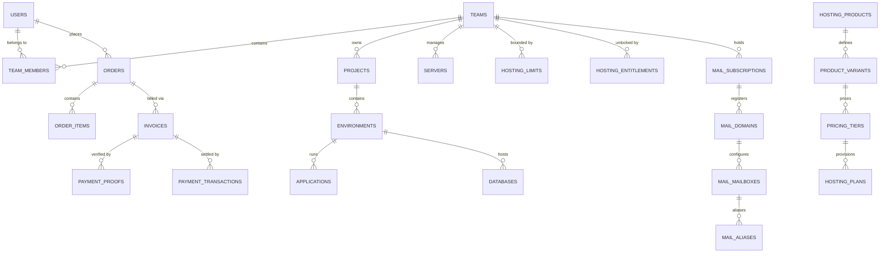

# Database Schema, Multi-Tenancy & Row Level Security (RLS)

## Overview

The STX Enterprises Cloud Platform utilizes **PostgreSQL 15 / 16** as its primary relational engine, supplemented by a dedicated PostgreSQL 15 database instance inside the self-hosted **Supabase BaaS** tier.

---

## 1. Core Data Model & Primary Key Philosophy

### Auto-CUID2 UUID Identifiers
All primary platform models extend `App\Models\BaseModel`, which automatically generates collision-resistant, sortable **CUID2 strings** for model UUIDs (e.g. `clh9x8y1z000008l09f1a2b3c`).
- Primary database relationships in the core control plane use integer autoincrement `id` internally and expose `uuid` externally.
- Route parameters, public URLs, and API endpoints always use `uuid` to prevent sequential enumeration (IDOR) attacks.

### Instance Sentinel Rows (`id = 0`)
The platform reserves primary key `id = 0` for instance-owned singleton and sentinel records:

| Sentinel Record | Model | Description |
|---|---|---|
| **Root Team** | `Team::find(0)` | The platform administrator and root team (`team_id === 0`). Exempt from quotas and payment gates. |
| **Localhost Server** | `Server::find(0)` | The host machine running the STX control plane itself. |
| **Instance Settings** | `InstanceSettings::find(0)` | Singleton configuration table for the STX instance. |
| **Instance PostgreSQL** | `StandalonePostgresql::find(0)` | STX Hosting's own database instance (`stx-db`). |
| **Local Destination** | `StandaloneDocker::find(0)` | The default Docker destination on localhost. |

> [!CAUTION]
> **Never modify or resequence `id = 0` rows**. In PHP/Eloquent, `empty(0)` evaluates to `true`. Keyset pagination queries starting at `id > 0` will skip instance sentinels. Always use `chunkById()` or pagination queries without a strict positive lower bound.

---

## 2. Multi-Tenant Isolation & Scoping Rules

The platform isolates clients by **Teams** (`Team` model). Every client belongs to their own team; platform staff belong to team `0`.

### 5-Tier Client Role Matrix

Client teams support 5 hierarchical and functional roles:

| Role | Rank | Capabilities | Typical Use |
|---|---|---|---|
| `owner` | 5 | All actions: team deletion, ownership transfer, billing, member invites, deployments, domains, servers. | Account/Organization creator |
| `admin` | 4 | Member invites and management, billing, deployments, custom domains, servers. | Tech leads, co-founders |
| `developer` | 3 | Deploy applications, configure custom domains, access servers and consoles. No member or billing access. | Software engineers, DevOps |
| `billing` | 2 | View and pay invoices, submit payment proofs, manage payment methods and receipts. No technical or deployment access. | Accountants, financial managers |
| `viewer` / `member` | 1 | Read-only view of deployed applications, services, and team profile. | External stakeholders, auditors |

### Scoping Rules for Developers & AI Agents
1. **Never rely on UI `@can` directives for authorization**: All reads, queries, and mutations must be authorized server-side using policies, gates (`$this->authorize(...)`), or `RbacService`.
2. **Session Team vs Resource Team**:
   - The session team (`currentTeam()`, `Model::ownedByCurrentTeam()`) must **only** be used for initial page loading and "my resources" listing.
   - Once an existing resource is loaded (e.g. an Application, Database, or Server), **all subsequent permissions, related record lookups, and child records must be scoped to `$resource->team_id`**, NOT the session team. A user could switch teams in another browser tab while keeping the current view open.
3. **Pessimistic Row Locking**:
   - Critical commercial records (`Invoice`, `PaymentProof`, `HostingEntitlement`) must be mutated inside database transactions with row-level pessimistic locks (`lockForUpdate()`) to prevent race conditions during concurrent approval or checkout.

---

## 3. Entity Relationship Diagram (Commerce & Hosting)

---

## 4. Key Models & Schemas

### Core Infrastructure
- `Server`: Managed physical node or VPS connected via SSH. Stores IP, port, SSH credentials, proxy type (`traefik`/`caddy`), settings, and validation status.
- `Application`: Deployed containerized application. Tracks repository URL, branch, buildpack (`dockerfile`, `compose`, `nixpacks`), port mappings, environment variables, and health check URLs.
- `Service`: Multi-container stack deployed from curated compose templates.
- `StandalonePostgresql`, `StandaloneMysql`, `StandaloneRedis`, `StandaloneMongodb`: Individual managed database instances with backup and restoration configurations.

### Commercial & Entitlements Tier
- `HostingProduct`: Base product catalog item (`vps`, `app`, `database`, `email_hosting`, `game_server`).
- `HostingPlan`: Plan specifications (e.g. `starter`, `pro`, `business`) defining resource allocations (vCPU, RAM MB, storage GB, bandwidth).
- `Order` & `OrderItem`: Customer purchase records linking to chosen pricing tiers and billing terms (`monthly`, `quarterly`, `annual`).
- `Invoice`: Billed invoice tracking total cents, currency (e.g. `LKR`, `USD`), payment reference, due date, paid timestamp, and lifecycle state (`unpaid`, `verifying`, `paid`, `cancelled`, `refunded`).
- `PaymentProof`: Bank transfer and cash deposit receipts uploaded by customers. Stores file path on the private proof disk, pure-pixel sanitization status, perceptual dHash, extracted AI metadata, confidence score, discrepancies, and reviewer ID.
- `HostingEntitlement`: Active capability grants unlocked by paid invoices. Tracks status (`active`, `suspended`, `expired`), start date, end date, and associated server/service instances.
- `HostingLimit`: Global defaults and per-team resource limits across projects, containers, CPU cores, RAM, storage, and databases.
- `TemplatePermission`: Access controls governing which curated application templates are globally enabled or restricted to specific hosting plans.

### Mail Hosting & Security Delegation Models
- `MailPlan`: Pooled email hosting plans defining total storage pool (e.g. 5 GB to 100 GB) and baseline mailbox limits.
- `MailSubscription`: Customer email hosting entitlement linked to a team.
- `MailDomain`: Verified sending/receiving domains configured on the WildDuck mail server. Tracks MX, SPF, DKIM, and DMARC verification flags.
- `MailMailbox`: Individual mailboxes (`user@domain.com`) provisioned in WildDuck with assigned quota, credentials, and sensitive flags.
- `MailAlias`: Forwarding email aliases routing to specific mailboxes.
- `MailboxPermission`: Fine-grained staff authorization grants (`read_only`, `read_write`, `send_as`, `manage`) for customer support and administration.
- `MailAppPassword`: Revocable app-specific passwords for third-party desktop/mobile IMAP/SMTP clients.
- `MailboxAuditLog`: Immutable audit trail recording every staff mailbox inspection, credential reveal, or webmail delegation.
- `LoginVerificationCode`: 6-digit cryptographic two-factor verification codes stored as bcrypt hashes with 10-minute TTLs and 5-attempt rate limits.
- `EmailDeliveryLog`: Delivery state tracking for outgoing transactional emails and verification codes.

---

## 5. Self-Hosted Supabase Row Level Security (RLS) Policies

When using the self-hosted Supabase BaaS, all tables enforce PostgreSQL **Row Level Security (RLS)**. Unprivileged API queries via PostgREST cannot access data across tenant boundaries.

### Helper Functions Defined in Supabase
- `auth.uid()`: Returns the UUID of the currently authenticated user from the JWT.
- `auth.is_admin()`: Returns `true` if the user holds the `admin` or `owner` platform role.
- `auth.is_owner()`: Returns `true` if the user holds the `owner` platform role.
- `auth.belongs_to_team(team_id UUID)`: Returns `true` if the authenticated user is an active member of the specified team.

### Primary RLS Policies Summary

| Table | Operation | Allowed Roles | Policy Condition (`USING` / `WITH CHECK`) |
|---|---|---|---|
| `public.profiles` | `SELECT` | `authenticated` | `id = auth.uid() OR auth.is_admin()` |
| `public.profiles` | `UPDATE` | `authenticated` | `id = auth.uid() OR auth.is_owner()` |
| `public.teams` | `SELECT` | `authenticated` | `auth.belongs_to_team(id) OR auth.is_admin()` |
| `public.teams` | `UPDATE` | `authenticated` | Team admin/owner or `auth.is_admin()` |
| `public.template_permissions` | `SELECT` | `anon`, `authenticated` | `is_globally_enabled = true OR auth.is_admin()` |
| `public.template_permissions` | `ALL` | `authenticated` | `auth.is_admin()` |
| `public.products` | `SELECT` | `anon`, `authenticated` | `is_active = true OR auth.is_admin()` |
| `public.products` | `ALL` | `authenticated` | `auth.is_admin()` |
| `public.orders` | `SELECT` | `authenticated` | `user_id = auth.uid() OR auth.is_admin()` |
| `public.orders` | `INSERT` | `authenticated` | `user_id = auth.uid()` |
| `public.invoices` | `SELECT` | `authenticated` | `user_id = auth.uid() OR auth.is_admin()` |
| `public.payment_proofs` | `SELECT` | `authenticated` | `user_id = auth.uid() OR auth.is_admin()` |
| `public.payment_proofs` | `INSERT` | `authenticated` | `user_id = auth.uid()` |
| `public.payment_proofs` | `UPDATE` | `authenticated` | `auth.is_admin()` (Customers cannot alter reviewed proofs) |
| `public.hosting_entitlements`| `SELECT` | `authenticated` | `auth.belongs_to_team(team_id) OR auth.is_admin()` |
| `public.hosting_entitlements`| `ALL` | `authenticated` | `auth.is_admin()` (Entitlements managed strictly by engine/staff) |
| `public.deployments` | `SELECT` | `authenticated` | `auth.belongs_to_team(team_id) OR auth.is_admin()` |
| `public.custom_domains` | `SELECT` | `authenticated` | `auth.belongs_to_team(team_id) OR auth.is_admin()` |
| `public.custom_domains` | `ALL` | `authenticated` | `auth.belongs_to_team(team_id) OR auth.is_admin()` |
| `public.audit_logs` | `SELECT` | `authenticated` | `auth.is_admin()` |

### Storage Bucket RLS Policies
Storage buckets managed by Supabase Storage (`storage.objects`) enforce the following rules:
- `logos` & `template-assets`: Public read (`FOR SELECT TO anon, authenticated USING (bucket_id IN ('logos', 'template-assets'))`). Admin-only write.
- `invoices`: Authenticated read restricted to the invoice recipient user ID or platform admins.
- `payment-proofs`: Strictly private. Upload allowed by the invoice owner; read access restricted strictly to platform finance staff (`auth.is_admin()`) and transient expiring signed URLs.
