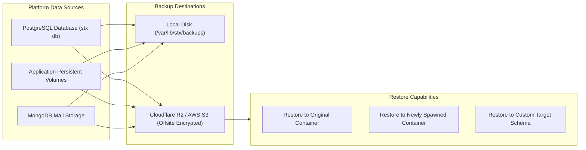

# Deployment, Infrastructure & Operational Runbook

## Overview

This guide details the deployment, day-to-day operations, backup procedures, upgrade workflows, and monitoring mechanisms for STX Enterprises Cloud Platform.

---

## 1. Production Deployment: All-In-One Self-Hosted Stack

The master compose file `docker-compose.selfhosted.yml` coordinates the complete platform:
- **STX Hosting Core Application** (Laravel 12, Livewire 3, Reverb, Terminal daemon)
- **PostgreSQL 15 / 16** & **Redis 7**
- **Self-Hosted Supabase BaaS** (Kong Gateway, GoTrue, PostgREST, Realtime, Storage, Studio)
- **WildDuck Email Hosting** (Haraka SMTP, Zone-MTA, Dovecot IMAP, MongoDB 6)
- **STX Webmail UI** (`webmail-ui` on PHP-FPM / Nginx)
- **Caddy Reverse Proxy** (Automatic ACME TLS termination)

### 1.1 Prerequisites
- **Linux Server**: Ubuntu 22.04 or 24.04 LTS (x86_64 or arm64).
- **Hardware Minimums**: 4 CPU cores, 8 GB RAM, 80 GB SSD/NVMe storage. (16 GB RAM recommended for multi-tenant deployments).
- **Public Ports Required**:
  - `80` (HTTP) & `443` (HTTPS) — Caddy & Traefik web traffic.
  - `25` (Inbound SMTP) — Haraka mail receiving.
  - `587` (Submission SMTP) — Zone-MTA authenticated outbound mail.
  - `993` (IMAPS) — Dovecot secure mail retrieval.
  - `8000` (Control Plane) & `6001` (Reverb WebSockets).

### 1.2 Step-by-Step Production Launch
```bash
# 1. Clone repository
git clone https://github.com/your-org/stx-hosting.git /srv/stx
cd /srv/stx

# 2. Configure environment files
cp .env.selfhosted.example .env
cp .env.supabase.example .env.supabase

# 3. Edit .env with your domain and secrets
nano .env

# 4. Generate application key
docker compose -f docker-compose.selfhosted.yml run --rm stx php artisan key:generate

# 5. Run database migrations and seed default catalog & sentinel records
docker compose -f docker-compose.selfhosted.yml run --rm stx php artisan migrate --seed --force
docker compose -f docker-compose.selfhosted.yml run --rm stx php artisan db:seed --class=HostingCatalogSeeder --force
docker compose -f docker-compose.selfhosted.yml run --rm stx php artisan db:seed --class=NativeStatusMonitorSeeder --force

# 6. Launch the unified stack in detached mode
docker compose -f docker-compose.selfhosted.yml up -d
```

### 1.3 Unified Single Start / Stop / Update Procedure

The entire self-hosted enterprise platform is orchestrated with healthcheck dependencies:

#### Start Entire Platform
```bash
docker compose -f docker-compose.selfhosted.yml up -d
```
Services start in dependency order with health gates:
1. `supabase-db` (Postgres 15 with pg_isready healthcheck)
2. `wildduck-mongo` (MongoDB 6 with mongosh admin ping healthcheck) & `wildduck-redis` (Redis 7 with redis-cli ping healthcheck)
3. `supabase-kong` (API Gateway with kong healthcheck) & Core Services (`wildduck`, `zonemta`, `supabase-auth`, `supabase-rest`, `supabase-realtime`, `supabase-storage`)
4. Edge reverse proxy (`caddy`) and Frontend (`webmail`, `webmail-php`, `discord-bot`)

#### Check Health & Readiness Status
```bash
docker compose -f docker-compose.selfhosted.yml ps
```
Ensure all stateful services report `healthy` or `running`.

#### Stop Platform Gracefully
```bash
docker compose -f docker-compose.selfhosted.yml down
```

#### Zero-Downtime Update Procedure
```bash
# Pull latest repository code and images
git pull origin main
docker compose -f docker-compose.selfhosted.yml pull

# Recreate updated containers
docker compose -f docker-compose.selfhosted.yml up -d --remove-orphans

# Run migrations and refresh caches
docker compose -f docker-compose.selfhosted.yml exec -T stx php artisan migrate --force
docker compose -f docker-compose.selfhosted.yml exec -T stx php artisan config:cache
docker compose -f docker-compose.selfhosted.yml exec -T stx php artisan horizon:terminate
```

---

## 2. Local Development Environments

### Option A: Standard Dev Container Stack
```bash
docker compose -f docker-compose.yml -f docker-compose.dev.yml up -d
```

### Option B: Worktree Dev Multi-Instance (`./scripts/dev`)
For developers working across multiple Git branches simultaneously:
```bash
./scripts/dev start          # Starts isolated containers, ports, and VMs for current branch
./scripts/dev urls           # Displays active ports and service endpoints
./scripts/dev exec php artisan migrate
./scripts/dev stop           # Stops current branch instance while retaining database volume
./scripts/dev destroy <name> # Teardown instance and release assigned port block
```

---

## 3. Backup & Disaster Recovery Policies



### 3.1 Multi-Target Database Restores (`RestoreDatabaseBackupJob`)
Unlike traditional restore scripts that overwrite active databases, STX Hosting supports three restore targets:
1. **Original Target**: Restores snapshot directly into the running source database container.
2. **New Standalone Instance**: Automatically provisions an isolated, newly spawned database container and restores the dump.
3. **Custom Target Schema**: Injects the backup into a designated staging or testing schema.

### 3.2 Volume Snapshots
Application volume backups (`/portal/backups`) capture persistent Docker volumes on demand or via cron schedules, streaming compressed tarballs to local disks or Cloudflare R2 / S3.

---

## 4. Platform Upgrade Procedures

STX Hosting includes an automated self-upgrade engine:

```bash
# 1. Trigger upgrade script targeting specific release tag or commit SHA
bash scripts/upgrade.sh v4.5.0

# 2. Rebuild configuration cache inside the container
docker exec stx php artisan config:cache

# 3. Run new database migrations
docker exec stx php artisan migrate --force

# 4. Restart Horizon supervisor queues to pick up updated job classes
docker exec stx php artisan horizon:terminate
```

---

## 5. Monitoring & Operational Health

- **Laravel Horizon Dashboard**: Accessible at `http://localhost:8000/horizon` (Restricted to Root Team / Owner accounts). Monitored queues: `high`, `deployments`, `maintenance`, `crons`, `webhooks`.
- **Public Status Page**: Accessible at `http://localhost:8000/status` displaying 90-day uptime heatmaps and privacy-preserving host node telemetry.
- **Background Health Prober**: `php artisan status:probe` runs every minute, probing TCP ports, HTTP endpoints, and container states.
