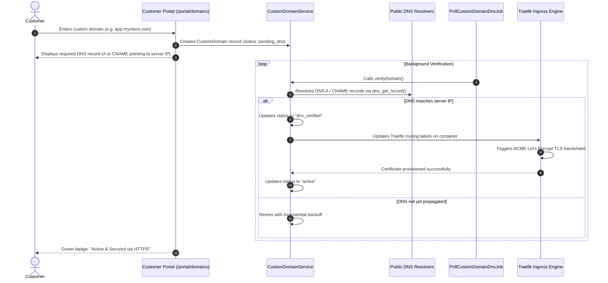

# Domains, DNS Verification & Automated SSL/HTTPS

## Overview

STX Enterprises Cloud Platform provides complete domain lifecycle management, multi-provider DNS verification, and zero-touch automatic SSL/TLS certificate issuance.

---

## 1. Domain Types Supported

1. **System Default Subdomains**: Auto-generated subdomains on platform wildcards (e.g. `app-xyz.stxhosting.com` or local `*.sslip.io` for development).
2. **Customer Custom Domains**: Custom Apex domains (`example.com`) or subdomains (`shop.example.com`) attached to containerized applications.
3. **Mail Hosting Domains**: Email domains configured on the WildDuck mail server requiring MX, SPF, DKIM, and DMARC records.
4. **Internal Platform Endpoints**: Root domain, customer portal, webmail UI, and status page endpoints.

---

## 2. Ingress & Reverse Proxy Architecture

The platform uses two specialized reverse proxies:

```
┌────────────────────────────────────────────────────────────────────────┐
│ INCOMING INTERNET TRAFFIC (Ports 80 & 443)                             │
└───────────────────┬────────────────────────────────┬───────────────────┘
                    │                                │
                    ▼                                ▼
┌──────────────────────────────────────┐   ┌─────────────────────────────┐
│ TRAEFIK REVERSE PROXY                │   │ CADDY REVERSE PROXY         │
│ (Managed Server Nodes)               │   │ (Mail & Core Endpoints)     │
│ • Container discovery via labels     │   │ • Automated Let's Encrypt   │
│ • Let's Encrypt HTTP-01 / DNS-01     │   │ • WildDuck Webmail UI       │
│ • Customer applications & templates  │   │ • WildDuck API endpoints    │
│ • Dynamic route reconfiguration      │   │ • HTTP to HTTPS redirects   │
└──────────────────────────────────────┘   └─────────────────────────────┘
```

---

## 3. Customer Custom Domain Lifecycle



---

## 4. Mail Domain DNS Verification (WildDuck)

For customer email hosting (`/portal/mail/domains`), four DNS records are required and verified before mail delivery is enabled:

| Record Type | Hostname / Name | Target / Value | Purpose |
|---|---|---|---|
| **MX** | `@` (or subdomain) | `10 mail.yourdomain.com` | Directs inbound email to Haraka SMTP server |
| **TXT (SPF)** | `@` | `v=spf1 mx a:mail.yourdomain.com ~all` | Authorizes Zone-MTA to send on domain's behalf |
| **TXT (DKIM)**| `s1._domainkey` | `k=rsa; p=MIGfMA0GCSqGSIb3...` | Cryptographic signature verifying message authenticity |
| **TXT (DMARC)**| `_dmarc` | `v=DMARC1; p=quarantine; rua=mailto:dmarc-reports@yourdomain.com` | Enforces SPF/DKIM policy on receiving servers |

### Verification Engine
- `WildDuckProvisioningService::verifyDomainDns(MailDomain $domain)` inspects live records using `dns_get_record()`.
- The Mail Dashboard displays real-time status badges (Valid / Missing / Misconfigured) for each record.
- Once DKIM and SPF validate, outgoing messages automatically receive high sender-reputation scores.

---

## 5. Automated SSL/TLS Engine

### 5.1 Traefik ACME Automation (Applications)
- For every running container, STX Hosting injects Docker labels:
  ```yaml
  traefik.enable: "true"
  traefik.http.routers.app-123.rule: "Host(`app.example.com`)"
  traefik.http.routers.app-123.entrypoints: "https"
  traefik.http.routers.app-123.tls.certresolver: "letsencrypt"
  ```
- Traefik automatically negotiates the HTTP-01 challenge with Let's Encrypt and stores certificates in `/traefik/acme.json` on the server node.
- Certificates renew automatically 30 days prior to expiration.

### 5.2 Caddy ACME Automation (Mail & Core Stack)
- Caddy manages certificates for mail server hostnames, the webmail client, and core platform domains defined in `docker/caddy/Caddyfile`:
  ```caddyfile
  {$MAIL_SERVER_HOSTNAME} {
      reverse_proxy wildduck:8080
  }
  {$WEBMAIL_DOMAIN} {
      reverse_proxy webmail:80
  }
  ```
- Caddy handles HTTP-to-HTTPS redirection, modern TLS 1.3 ciphers, and automated renewal.

---

## 6. Cloudflare & Domain Connect Integration

- **Cloudflare API**: Configured via `CLOUDFLARE_API_TOKEN` and `CLOUDFLARE_ZONE_ID` for automated DNS record creation, cache purging, and proxy bypass rules.
- **Domain Connect**: Supported via `DOMAIN_CONNECT_PROVIDER_ID` and private key signing, allowing 1-click DNS configuration for customers using Cloudflare or GoDaddy DNS.
