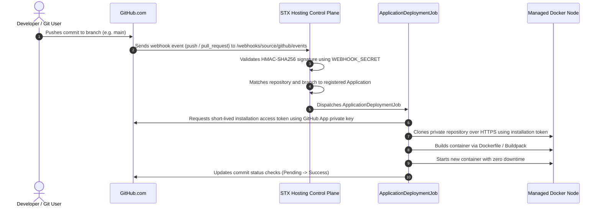

# GitHub App Integration & Repository Deployments

## Overview

STX Enterprises Cloud Platform provides seamless integration with GitHub for deploying both **public** and **private** repositories with automated builds, preview environments, and Git-push webhooks.

---

## 1. Integration Methods

### 1.1 Public Git Repositories
- Any public GitHub repository can be deployed without credentials.
- The user provides the Git clone URL (e.g. `https://github.com/org/repo.git`), branch, and build configuration.

### 1.2 Private GitHub Repositories (GitHub App)
- Deploying private repositories uses a dedicated **GitHub App** configured under **Sources > GitHub App** (`/source/github`).
- Benefits over personal access tokens (PATs) or deploy keys:
  - Granular, repository-level permissions.
  - Automatic deployment webhooks configured during app installation.
  - Organization-wide access without sharing user credentials.
  - Native commit status updates on pull requests.

---

## 2. GitHub App Architecture & Permissions

### Required GitHub App Permissions
When registering a GitHub App for STX Hosting, the following permissions are configured:

| Permission | Access | Purpose |
|---|---|---|
| **Repository contents** | `Read-only` | Clones source code and reads Dockerfiles / compose files |
| **Commit statuses** | `Read & write` | Posts build progress and deployment health badges to commits |
| **Pull requests** | `Read-only` | Required for automated preview environment deployments |
| **Webhooks** | `Read-only` | Receives push and pull request event notifications |

---

## 3. Buildpack & Container Engines

STX Hosting supports multiple build methods for Git repositories:

1. **Dockerfile (Recommended)**: Builds directly using the repository's `Dockerfile`. Provides maximum transparency, determinism, and performance.
2. **Docker Compose**: Builds and runs multi-container stacks defined in `docker-compose.yml`.
3. **Cloud Native Buildpacks (CNB) / Railpack**: Automatic framework detection and container compilation without requiring a Dockerfile.
4. **Nixpacks**: Supported for legacy configurations. *(Note: Nixpacks is deprecated across the platform; new projects should use Dockerfile or Railpack).*

---

## 4. Git Deployment Tiers (Customer Portal)

In the Customer Self-Service Portal (`/portal/deploy`), Git deployments are available across three standard tiers:

| Tier Slug | RAM Limit | vCPU Bound | Storage | Preview Deployments |
|---|---|---|---|---|
| `git-starter` | 512 MB | 0.5 vCPU | 5 GB | Disabled |
| `git-standard`| 2 GB | 1.0 vCPU | 20 GB | 1 Active Preview |
| `git-pro` | 4 GB | 2.0 vCPU | 50 GB | 3 Active Previews |

Container runtime bounds (`mem_limit`, `cpus`) are strictly injected into the Docker daemon during build execution, preventing noisy-neighbor issues on shared application nodes.
