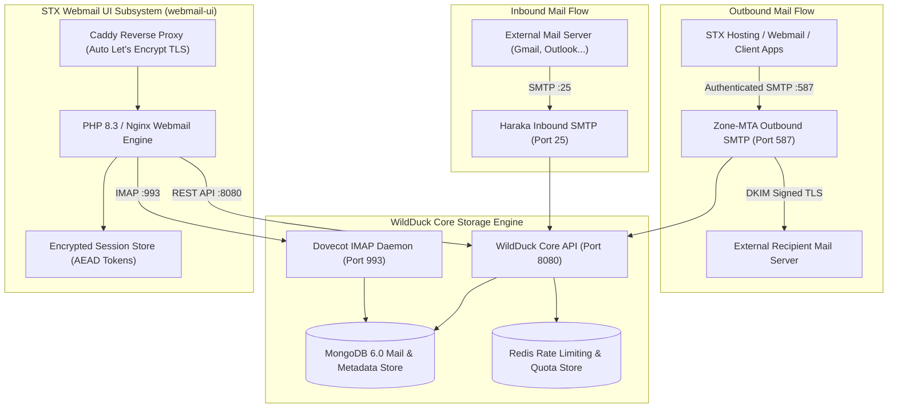

# Mail System Architecture & STX Webmail

## Overview

STX Enterprises Cloud Platform features a fully integrated, self-hosted, enterprise-grade email infrastructure powered by the **WildDuck Mail Stack**, automated **Caddy TLS**, and the proprietary **STX Webmail UI** (`webmail-ui`).

---

## 1. Mail Infrastructure Architecture

---

## 2. Component Directory & Stack Specifications

| Component | Technology | Version | Purpose |
|---|---|---|---|
| **WildDuck API** | Node.js | `1.55.2` | Core email server API, mailbox CRUD, message search and retrieval |
| **Haraka** | Node.js | Latest | High-performance inbound SMTP daemon with anti-spam and recipient validation |
| **Zone-MTA** | Node.js | Latest | Outbound delivery MTA with automated DKIM signing and connection pooling |
| **Dovecot** | C / Native | Latest | IMAP server providing standard mail client access (Thunderbird, Apple Mail) |
| **MongoDB** | MongoDB | `6.0` | High-volume document database storing email MIME messages and folders |
| **Redis** | Redis | `7.0` | Delivery queues, rate limiting, and temporary state |
| **Caddy Proxy**| Go | `2.8` | Automatic ACME Let's Encrypt TLS termination for webmail and API endpoints |
| **STX Webmail**| PHP / Nginx | `8.3+` | Lightweight, dependency-free webmail client with deep-linking |

---

## 3. Commercial Email Hosting & Pooled Storage Plans

The platform provides multi-tier email hosting through `App\Models\Commerce\MailPlan`:

| Plan Slug | Storage Pool | Default Mailboxes | Default Domains | Description |
|---|---|---|---|---|
| `starter` | **5 GB** | 5 | 1 | Freelancers and personal brands |
| `basic` | **15 GB** | 15 | 2 | Small businesses and startups |
| `pro` | **50 GB** | 50 | 5 | Growing companies with multi-domain needs |
| `business` | **100 GB** | Unlimited | 10 | Enterprise teams with high email volume |

### Modular Add-ons (`MailAddon`)
Customers can expand their subscription with incremental add-on quotas:
- **Extra Storage**: +10 GB, +25 GB, or +50 GB pooled storage.
- **Extra Mailboxes**: +5 or +10 individual accounts.
- **Extra Domains**: +1 or +3 additional custom domains.

---

## 4. Mailbox & Domain Provisioning Engine

All mail operations are managed via `App\Services\Commerce\WildDuckProvisioningService`:

### Mailbox Creation Workflow
1. Client submits mailbox details (`username`, `domain`, `password`, `quota_mb`) in `/portal/mail`.
2. Service verifies subscription storage limits: `SUM(mailboxes.quota_mb) + new_quota <= plan.pool_mb`.
3. Calls WildDuck API `POST /users` to create the account in MongoDB.
4. Stores `MailMailbox` record linking the local user and WildDuck user ID.
5. Emits real-time event and provides IMAP/SMTP connection settings.

### Alias Provisioning
- Creates forwarding aliases via WildDuck API `POST /users/{id}/addresses`.
- Validates that forwarding addresses belong to verified team domains.

### Admin Access Permissions & Staff Delegation (`MailboxAuthorizationService`)
Platform staff access to mailboxes is governed by fine-grained permissions defined in `MailboxPermission`:
- **Permission Levels**:
  - `read_only`: View messages and folders without mutation abilities.
  - `read_write`: View, reply, compose drafts, and organize folders.
  - `send_as`: Outbound transmission rights acting as the mailbox identity.
  - `manage`: Full administrative access to aliases, passwords, and forwarding rules.
- **Sensitive Mailbox Step-Up Security**:
  - Mailboxes flagged `is_sensitive` (such as executive, legal, or finance addresses) enforce **2FA step-up re-authentication** (`requiresStepUp()`). Staff must confirm their password/code within the past 15 minutes before viewing contents or launching Webmail.
- **Audit Logging (`MailboxAuditLog`)**:
  - Every staff access, credential reveal, or webmail session delegation generates an immutable audit record with user ID, IP address, action, and timestamp.
- **App-Specific Passwords (`MailAppPassword`)**:
  - Allows generating isolated, revocable credentials for third-party desktop and mobile IMAP/SMTP clients without exposing primary account passwords.
- **System Mappings (`MailSystemMapping`)**:
  - Binds system notification categories (alerts, transactional billing, security notices) to dedicated platform mailboxes.

---

## 5. Automated Transactional Emails & Invoices

The platform issues automated emails using customizable templates managed in `App\Services\Notifications\EmailTemplates`:

- **Invoice Generated**: Sent upon order placement with printable PDF link.
- **Payment Verification Alerts**: Dispatched when deposit slip is received, approved, or rejected.
- **Automated Renewal Invoices**: Dispatched 7 days prior to entitlement expiration (`GenerateRenewalInvoicesJob`).
- **Overdue Suspension Notices**: Dispatched upon expiration of the 4-day grace period (`ProcessOverdueSuspensionsJob`).
- **VPS Provisioning Delivery**: Delivers server IP, SSH port, and credentials access instructions.
- **Printable Invoices**: Generated via `InvoicePdfService` using DomPDF with official tax breakdown and bank remittance details.

---

## 6. STX Webmail UI (`webmail-ui`)

The STX Webmail UI is a standalone, ultra-lightweight PHP 8.3 application located in `webmail-ui/`:

### Key Features
1. **Zero Runtime NPM/Composer Dependencies**: Runs on native PHP 8.3 FPM and Nginx for maximum performance and minimal attack surface.
2. **Multi-Account Session Switching**: Up to 5 WildDuck email accounts can be signed in simultaneously in a single browser session (`/accounts/add`). Tokens are stored in server-side sessions encrypted with AEAD (`sodium`).
3. **Real-Time Notification Polling**: `public/assets/notify.js` polls `GET /api/notify` with exponential backoff, updating unread badges, tab titles, and desktop notifications.
4. **Metadata Storage**: Contacts and rich email signatures are persisted directly in WildDuck's `metaData.webmail` field without requiring a separate database.
5. **Portal Deep-Linking**: Single-click access from the Customer Portal (`/portal/mail`) directly into the webmail inbox.
