# Multi-Node Server Management & SSH Orchestration

## Overview

STX Enterprises Cloud Platform operates as a distributed multi-node control plane. The platform orchestrates servers and containers remotely over secure **SSH connections** using pure SSH and Docker APIs, eliminating the need for heavy custom host agents on managed worker machines.

---

## 1. Node Hierarchy & Classification

| Node Type | ID | Managed By | Purpose |
|---|---|---|---|
| **Localhost Server** | `id = 0` | Instance Sentinel | The server running the STX Hosting control plane itself. Runs instance backups, internal Redis, and self-hosted services. |
| **Shared Application Nodes**| `id > 0` | Platform Admins | Shared multi-tenant Docker servers where customer applications and templates are deployed with strict cgroups memory and CPU bounds. |
| **Dedicated Customer VPS** | `id > 0` | Customer & Ops | Standalone virtual machines delivered to customers via the VPS fulfillment queue. Isolated root credentials and dedicated resources. |

---

## 2. SSH Connection Architecture & Sudo Handling

```mermaid
flowchart LR
    ControlPlane["STX Control Plane (stx container)"]
    SSHClient["phpseclib / Native SSH Client"]
    RemoteNode["Remote Linux Host (Ubuntu 22.04 / 24.04 LTS)"]
    DockerDaemon["Remote Docker Engine (dockerd)"]
    TraefikIngress["Traefik Ingress Proxy Container"]

    ControlPlane --> SSHClient
    SSHClient -->|SSH Keypair Port 22/Custom| RemoteNode
    RemoteNode -->|Sudo Parser: parseCommandsByLineForSudo| DockerDaemon
    DockerDaemon --> TraefikIngress
```

### SSH Key Deployment & Validation
- Platform generates an ed25519 or RSA 4096-bit keypair upon installation (`PrivateKey` model).
- Worker nodes are onboarded by adding the platform's public key to the remote user's `~/.ssh/authorized_keys`.
- Onboarding validation (`php artisan server:validate`) verifies:
  1. SSH connectivity and latency.
  2. Operating system compatibility (Debian/Ubuntu/CentOS/Fedora).
  3. Docker Engine and Docker Compose v2 presence (auto-installs if missing).
  4. Sudo elevation permissions without tty prompts.

### Non-Root Sudo Command Parser
When the SSH user is not `root`, commands pass through `parseCommandsByLineForSudo()`.
- Commands with pipes (`|`), redirections (`>`, `>>`), subshells (`sh -c`, `bash -c`), and environment exports are systematically wrapped so that elevation applies correctly across the entire pipeline.
- Developers and agents adding remote shell commands must test against non-root sudo users.

### SSH Multiplexing (`SSH_MUX_ENABLED=true`)
In high-throughput environments, SSH multiplexing reuses persistent TCP sockets, reducing latency and handshakes when monitoring hundreds of remote containers.

---

## 3. Remote Telemetry & Health Probing

The platform monitors remote nodes using autonomous background console commands scheduled in `app/Console/Kernel.php`:

### 1. `php artisan status:probe` (Runs Every Minute)
- Iterates over active `Monitor` records.
- Tests TCP sockets, HTTP endpoints, and container states.
- Records response times in `monitor_checks`.
- Computes 90-day rolling uptime percentages for the public status page (`/status`).

### 2. `php artisan vps:collect-stats` (Runs Every Minute)
- Executes lightweight CPU, RAM, and disk utilization probes across active hypervisors and nodes.
- Stores telemetry in `ServerMetadata` and updates live metrics on the admin console and customer portal.

### 3. `php artisan vps:check-delivery-sla` (Runs Hourly)
- Audits pending VPS orders in `ProvisioningQueue`.
- Flags SLA breaches if manual provisioning exceeds target turnaround times.

---

## 4. Server Transfer Engine (Export & Import)

A server transfer moves a server and every record belonging to it (applications, databases, services, volumes, environment variables, backups, scheduled tasks, tags, and settings) to another STX Hosting instance.

### Architecture
- **Exporter**: `App\Services\ServerTransfer\ServerTransferExporter` writes an encrypted, portable JSON bundle.
- **Importer**: `App\Services\ServerTransfer\ServerTransferImporter` unpacks and instantiates models on the target instance.
- **Coverage Authority**: `App\Services\ServerTransfer\ServerTransferCoverage` maintains exhaustive registries:
  - `TRANSFERRED`: Models explicitly migrated.
  - `NOT_TRANSFERRED`: Models deliberately excluded with documented reasons.
  - `NOT_EXPORTED_COLUMNS`: Columns excluded (e.g. local IDs, ephemeral timestamps).

### Transfer Invariants for Developers & AI Agents
1. **Never copy foreign keys as raw integers**: Primary keys differ on target instances. Records are linked by CUID2 UUIDs.
2. **Hidden and non-fillable columns**: Applications and databases export `$fillable` columns plus hand-maintained lists of hidden columns.
3. **Team credentials move with the server**: S3 storages, private keys, Git sources, and API tokens used by resources on that server are included in the bundle.
4. **Target validation tests**: Always verify changes against `tests/Unit/ServerTransfer/ServerTransferCoverageTest.php` and `tests/Unit/ServerTransfer/ServerTransferExporterImporterTest.php`.
