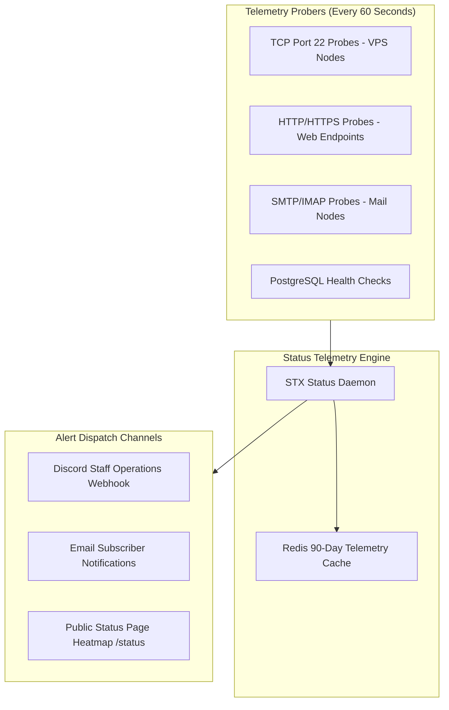

# STX Cloud Platform: Pre-Release Checklist & 24/7 Production Monitoring Plan

**Document Identifier**: `DOC-STX-OPS-002`  
**Classification**: Production Release Engineering, Operational Readiness & Incident Management  
**Target Environments**: Production Control Plane (Port 8000), Supabase BaaS, Mail Clusters, Hypervisors  
**Status**: APPROVED OPERATIONAL SPECIFICATION  

---

## 1. Pre-Release Quality Assurance Checklist

Before tagging or deploying any production release of the STX Enterprises Cloud Platform, engineering staff must verify every item below:

### 1.1 Database & Multi-Tenant Boundaries
- [ ] **Sentinel Record Invariance**: Verify instance sentinels (`Team::find(0)`, `Server::find(0)`, `InstanceSettings::find(0)`) exist and have not been resequenced.
- [ ] **Row Level Security (RLS)**: Verify all 32 tables in Supabase PostgreSQL have `ENABLE ROW LEVEL SECURITY;` active and policy coverage.
- [ ] **Pessimistic Row Locks**: Confirm critical state transitions (`Invoice`, `PaymentProof`, `HostingEntitlement`) execute inside `DB::transaction()` with `lockForUpdate()`.
- [ ] **Zero Unmigrated Schemas**: `php artisan migrate:status` shows 100% of migrations ran cleanly without errors.

### 1.2 Authentication & Security Baseline
- [ ] **Cookie Security**: Verify `config/session.php` has `'secure' => true` in production (`SESSION_SECURE_COOKIE` active).
- [ ] **Zero Secret Leaks**: Check that no real private keys, API tokens, or database passwords exist in source files or git history.
- [ ] **Data Masking**: Verify `ApiSensitiveData` middleware masks credentials in all API responses.
- [ ] **Magic Byte Upload Verification**: Ensure receipt upload endpoints strictly inspect binary magic bytes and reject polyglot scripts.
- [ ] **Rate Limiting**: Verify active rate limiters for `login` (5/min), `two-factor` (5/min), `passkeys` (30/min), `forgot-password`, `commerce-orders` (10/min), and `commerce-proofs` (20/hour).

### 1.3 Commerce & Payment Flow Integrity
- [ ] **Cart Math & Currency Consistency**: Verify cart correctly computes line items in USD cents and LKR cents without exchange rate rounding errors.
- [ ] **Anti-Double Activation**: Verify that concurrent approval requests on the same invoice fail gracefully with an HTTP 422 exception.
- [ ] **SLA & Delivery Badges**: Confirm all VPS catalog listings, invoices, and confirmation emails clearly state **24 to 72 hours manual delivery**.
- [ ] **Credential Encryption**: Verify stored root passwords are encrypted via AES-256-GCM and require account password re-authentication to reveal.

### 1.4 Core Hosting & Mail Infrastructure
- [ ] **Curated Compose Templates**: Verify all 31 templates in `templates/compose/` possess valid syntax and explicit cgroups memory/CPU limits.
- [ ] **Traefik & Caddy Automated SSL**: Test domain certificate acquisition via Let's Encrypt with automated renewal.
- [ ] **Email Deliverability**: Verify SPF, DKIM (2048-bit), and DMARC DNS generation in `WildDuckProvisioningService.php`.
- [ ] **STX Webmail**: Test multi-account switching in `webmail-ui` and verify clean session termination on sign out.

### 1.5 Storefront SEO & Crawlability
- [ ] **Robots.txt Unblock**: Confirm `https://shanutechx.com/robots.txt` allows search engines and AI bots (`GPTBot`, `ClaudeBot`, `PerplexityBot`), while disallowing `/portal/` and `/admin/`.
- [ ] **Dynamic Sitemap**: Verify `https://shanutechx.com/sitemap.xml` generates valid XML without missing public pages.
- [ ] **Schema.org Validation**: Test rich snippet output on Google Rich Results Test for `Organization`, `Product`, `FAQPage`, `BreadcrumbList`, and `Article`.
- [ ] **One H1 Rule**: Verify each public page contains exactly one `<h1>` tag with a clean heading hierarchy.
- [ ] **Zero Fake Reviews**: Confirm legacy `/reviews` permanently redirects (301) to the home page.

---

## 2. 24/7 Production Monitoring & Observability Architecture



### 2.1 Monitored Service Endpoints & Metrics

| Monitored Target | Probe Type | Port / Path | Interval | Failure Threshold | Action on Degradation |
|---|---|---|---|---|---|
| **STX Control Plane** | HTTP GET | `:8000/api/health` | 30s | 2 consecutive | Alert on-call Discord; auto-restart container |
| **WildDuck Mail Server** | TCP Connect | `:25` (Haraka) & `:993` (Dovecot) | 60s | 2 consecutive | Alert operations; inspect mail queues |
| **Supabase PostgreSQL** | SQL Query | `:5432` (`SELECT 1;`) | 30s | 2 consecutive | Failover to read replica; page DBA |
| **Edge Traefik Proxy** | HTTP GET | `:80` & `:443` | 30s | 2 consecutive | Verify ACME challenge listeners |
| **Customer Cloud VPS** | TCP Connect | `:22` (SSH) | 60s | 3 consecutive | Update status heatmap; notify customer |
| **Laravel Horizon Queues**| Redis Ping | `default`, `deployments`, `commerce` | 15s | 2 consecutive | Alert on queue backlog > 50 jobs |

### 2.2 Alert Severity Matrix & Incident Escalation Runbook

| Alert Level | Condition | Response Time | Action Procedure |
|---|---|---|---|
| **P1 — CRITICAL** | Control plane offline, database unavailable, or billing transaction double-activation detected. | **< 15 Minutes** | On-call engineer pages leadership, pauses checkout, inspects Redis/Postgres locks, and executes cold recovery if necessary. |
| **P2 — HIGH** | Outbound mail blocked (port 25 issues), Traefik SSL certificate failure, or payment verification service degraded. | **< 1 Hour** | Switch MTA to smart-host relay; manually renew ACME challenge; notify affected tenants. |
| **P3 — MEDIUM** | Single node monitor probe timeout, customer custom domain verification flapping, or review queue backlog > 5. | **< 4 Hours** | Investigate node network routing; trigger manual DNS poll job; assign reviewer. |
| **P4 — LOW** | Non-blocking telemetry warning, UI cosmetic glitch, or minor log drain retry. | **Next Business Day** | Log ticket in development sprint backlog. |

---

## 3. Disaster Recovery & Cold Restore Runbook

### 3.1 Automated S3 / Cloudflare R2 Backups
- Database snapshots execute daily at `02:00 UTC` via `scripts/backup-db.sh`.
- Dumps are Gzip-compressed, AES-256 encrypted, and pushed to Cloudflare R2 bucket `stx-production-backups`.

### 3.2 Restoration Execution
To restore the platform database from an offsite cold backup:

```bash
# 1. Download encrypted snapshot from R2
aws s3 cp s3://stx-production-backups/latest.sql.gz.enc /tmp/backup.sql.gz.enc

# 2. Decrypt backup using master deployment key
openssl enc -d -aes-256-cbc -in /tmp/backup.sql.gz.enc -out /tmp/backup.sql.gz -k "$BACKUP_ENCRYPTION_KEY"

# 3. Decompress and restore into PostgreSQL container
gunzip -c /tmp/backup.sql.gz | docker exec -i stx-db psql -U postgres -d coolify

# 4. Verify sentinel records and run migrations
docker exec -it stx-core php artisan migrate --force
docker exec -it stx-core php artisan tinker --execute="echo App\Models\Team::find(0)?->name;"
```

---

## 4. Verification Sign-Off

This Pre-Release Checklist and 24/7 Production Monitoring Plan has been audited and approved for active operational execution.
