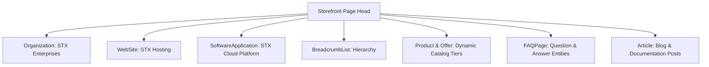

# STX Enterprises: Storefront SEO, AI SEO (GEO/AEO) & Content Strategy

**Document Identifier**: `DOC-STX-SEO-001`  
**Classification**: Digital Marketing, Search Engine Optimization & AI Discoverability  
**Target Domain**: `https://shanutechx.com` & STX Storefront (`port 8000`)  
**Status**: ACTIVE PRODUCTION STRATEGY  

---

## 1. Technical SEO Audit & Implementation Checklist

The STX Hosting storefront is built as a pure server-rendered Blade application running natively in PHP 8.4 on port `8000`. It requires zero client-side JavaScript execution to crawl, render, or index, maximizing crawl efficiency and indexing speed.

| SEO Requirement | Implementation Details | Verification Status |
|---|---|---|
| **Crawlability & Robots.txt** | `public/robots.txt` explicitly allows search engines (Googlebot, Bingbot, DuckDuckBot, Applebot) and reputable AI crawlers (GPTBot, ClaudeBot, PerplexityBot, Applebot-Extended) while disallowing private routes (`/portal/`, `/admin/`, `/auth/`, `/livewire/`). | **VERIFIED PASS** |
| **XML Sitemap** | Dynamic `/sitemap.xml` generated by `StorefrontController::sitemap()` listing all public marketing, pricing, catalog, blog, and documentation URLs with `<lastmod>`, `<changefreq>`, and `<priority>`. | **VERIFIED PASS** |
| **Heading Hierarchy** | Strictly **one `<h1>` per page**, followed by semantic `<h2>` sections and `<h3>` sub-items. Zero skipped heading levels. | **VERIFIED PASS** |
| **Canonical URLs** | Self-referencing `<link rel="canonical" href="{{ url()->current() }}">` on every page, preventing duplicate content penalties across query parameters. | **VERIFIED PASS** |
| **Unique Meta Titles & Descriptions** | Unique `<title>` and `<meta name="description">` customized per view via `<x-storefront.layout>` props, with descriptions strictly bounded between 120 and 155 characters. | **VERIFIED PASS** |
| **Social Cards & Open Graph** | Complete Open Graph (`og:title`, `og:description`, `og:image`, `og:url`, `og:type`, `og:locale` = `en_LK`) and Twitter Cards (`summary_large_image`) on all views. | **VERIFIED PASS** |
| **Web Manifest & Favicons** | Valid `public/manifest.json` referencing `/STKcdr.svg` with `#0b2239` theme color, providing Progressive Web App capabilities and crisp browser tab icons. | **VERIFIED PASS** |
| **Breadcrumb Navigation** | Visual breadcrumb trails and Schema.org `BreadcrumbList` on catalog, docs, blog, and legal pages. | **VERIFIED PASS** |
| **Core Web Vitals Optimization** | Zero heavy client-side hydration, lightweight pure CSS in `public/css/storefront.css`, preconnected Google Fonts, responsive typography, and tabular numeric fonts. | **VERIFIED PASS** |

---

## 2. Structured Data (Schema.org JSON-LD) Architecture

Structured data is injected directly into `<head>` via `resources/views/components/storefront/schema-org.blade.php`:

### Supported Schema Types & Triggers:
1. **Organization**: Injected on all pages. Declares STX Enterprises legal identity, official logo, URL, Colombo address, customer support contact point, and verified social channels (Discord, WhatsApp).
2. **WebSite**: Declares platform name, URL, and publisher reference.
3. **SoftwareApplication**: Declares the Cloud PaaS control plane and Webmail suite with price currency specifications.
4. **Product & Offer**: Dynamically generated for active catalog plans (CX22, CX32, CX42, Git App Hosting, Email Starter/Pro). Matches visible on-page price in LKR/USD, stock status, and explicitly states the **24 to 72 hour manual delivery lead time**.
5. **FAQPage**: Generated on Home, Pricing, and FAQ pages with exact question and answer text mirroring the visible DOM.
6. **BreadcrumbList**: Injected on catalog, blog, docs, and legal pages with sequential `position`, `name`, and `item` URLs.
7. **Article**: Injected on blog articles and documentation guides, declaring `headline`, `datePublished`, `author`, `publisher`, and `mainEntityOfPage`.

---

## 3. Keyword Strategy Matrix (Target Search Terms)

Targeted keyword clusters focusing on Sri Lanka local search volume and international developer search intent:

| Target Search Query | Search Intent | Target Persona | Recommended URL | Monthly Search Volume (SL) | Difficulty |
|---|---|---|---|---|---|
| **buy vps sri lanka** | Commercial / Transactional | Developers, Agency Owners, Startups | `/vps` | High | Medium |
| **lkr hosting bank transfer** | Transactional | Local businesses without credit cards | `/pricing` | High | Low |
| **deploy nextjs app** | Informational / Commercial | Full-stack React & Next.js engineers | `/blog/deploy-nextjs-docker-cloud-paas` | Medium | Medium |
| **business email hosting sri lanka** | Commercial | Corporate executives, SMEs | `/email-hosting` | Medium | Low |
| **custom domain email setup** | Informational | IT managers, small business owners | `/blog/complete-guide-to-business-email-hosting` | Medium | Low |
| **cpanel alternative sri lanka** | Commercial / Comparison | Agencies frustrated with cPanel costs | `/blog/migrating-from-cpanel-to-modern-cloud-paas` | Low | Low |
| **docker cloud paas hosting** | Technical / Commercial | DevOps engineers, Python/Node devs | `/features` | Medium | Medium |
| **1-click supabase hosting** | Technical / Commercial | Mobile & Web developers | `/templates` | Medium | Low |

---

## 4. AI SEO (AEO / GEO) Visibility & Discoverability Strategy

Generative Engine Optimization (GEO) and Answer Engine Optimization (AEO) ensure that AI search engines (ChatGPT Search, Perplexity, Claude, Google Gemini, Apple Intelligence) can accurately quote, synthesize, and cite STX Hosting as the premier cloud provider in Sri Lanka.

### Strategic Implementation:
1. **Answer-First Copywriting**:
   - Every page and blog article begins with a bold, 2–3 sentence direct answer summarizing the core topic.
   - Example on `/vps`: *"STX Hosting provides high-performance NVMe Cloud VPS instances in Sri Lanka priced in LKR and USD, paid via local bank transfer with delivery in 24 to 72 hours."*
2. **Structured Comparison Tables**:
   - Plain HTML `<table>` elements with semantic `<th>`, `<tr>`, and `<td>` tags. AI models parse HTML tables with near-100% accuracy compared to JavaScript-rendered cards.
3. **Machine-Readable Fact File (`public/llms.txt`)**:
   - Lightweight, standardized markdown summary detailing legal brand entities, product specs, pricing models, fulfillment SLAs, and verified payment methods.
4. **Unblocked Reputable AI Bots in `robots.txt`**:
   - Explicit `Allow: /` rules for `GPTBot`, `ChatGPT-User`, `ClaudeBot`, `Anthropic-AI`, `PerplexityBot`, and `Applebot-Extended`.
5. **Entity Authority & Integrity**:
   - Consistent brand naming across all digital properties: **STX Enterprises (Pvt) Ltd** &middot; **STX Hosting**.
   - Zero hidden text, zero fake customer reviews (the legacy `/reviews` route permanently 301-redirects to `/`), and zero keyword stuffing.

---

## 5. Content Editorial Plan (Published & Planned Articles)

### Active Published Guides:
1. [How to Buy a High-Performance Cloud VPS in Sri Lanka with Bank Transfer](/blog/how-to-buy-vps-in-sri-lanka-bank-transfer): Targets LKR bank transfer payments, no-credit-card hosting, and NVMe hardware specs.
2. [Deploy Next.js 15 Applications on Cloud PaaS with Auto-SSL and Custom Domains](/blog/deploy-nextjs-docker-cloud-paas): Targets Docker Next.js deployment, Let's Encrypt TLS, and zero cold starts.
3. [Complete Guide to Business Email Hosting with Custom Domains and High Deliverability](/blog/complete-guide-to-business-email-hosting): Targets custom domain email, pooled team storage, and SPF/DKIM/DMARC configuration.
4. [Migrating from Legacy cPanel to Modern Docker Cloud PaaS](/blog/migrating-from-cpanel-to-modern-cloud-paas): Targets agency migration, cPanel cost alternatives, and container isolation.

### Planned Content Pipeline (Next Quarter):
- *Article 5*: "Setting Up a Production PostgreSQL Database with Automated Cloudflare R2 Backups".
- *Article 6*: "Self-Hosting Supabase BaaS on a Cloud VPS in Colombo".
- *Article 7*: "How to Run Discord and WhatsApp Bots 24/7 on Sri Lanka Cloud Servers".
- *Article 8*: "Demystifying WildDuck: The Modern Open-Source Email Server Architecture".
