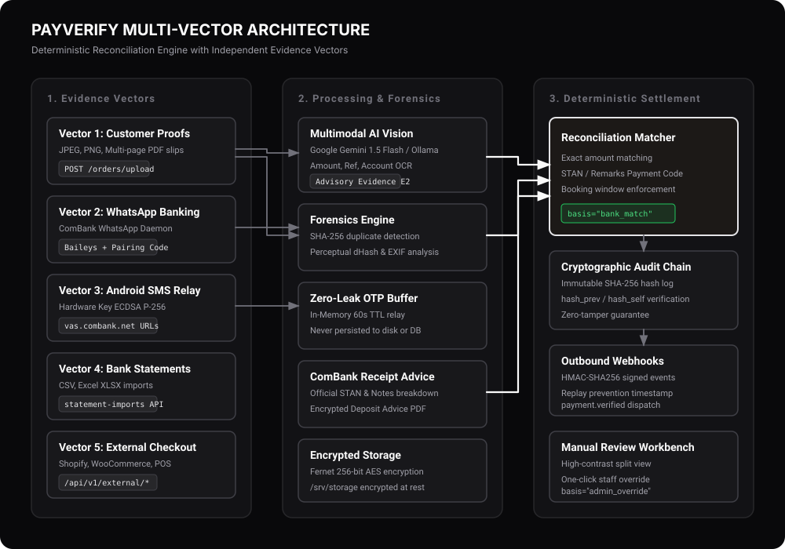
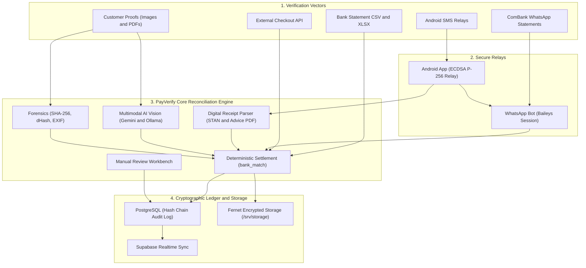

# PayVerify: Real-Time Bank Payment Verification Platform

[](https://github.com/payverify/payverify/actions)
[](https://www.python.org/downloads/)
[](https://nextjs.org/)
[](https://fastapi.tiangolo.com/)
[](LICENSE)

**PayVerify** is an enterprise-grade automated bank deposit and transfer verification engine designed for e-commerce stores, SaaS platforms, ERPs, and Point-of-Sale (POS) applications operating in Sri Lanka (specialized for **Commercial Bank of Ceylon PLC - ComBank**).

It completely eliminates manual statement reconciliation and payment fraud by combining **automated WhatsApp Banking statement sync (Baileys daemon with 8-digit Pairing Code & QR)**, **digital receipt advice parsing (STAN & note breakdown)**, **free multimodal visual AI proof extraction (Google Gemini 1.5 Flash / Local Ollama CPU)**, **zero-leak ephemeral Android OTP relay**, and an **external cross-platform verification API** with cryptographic webhooks.

---

## System Architecture



### Architecture Overview (Universal Text Rendering)

```text
+---------------------------------------------------------------------------------------------------------+
|                                        VERIFICATION VECTORS                                             |
| Customer Uploads (PNG/PDF) │ WhatsApp Banking Statements │ Android SMS Alerts │ Bank CSV/Excel Imports  |
+---------------------------------------------------------------------------------------------------------+
                    │                            │                     │                     │
                    ▼                            ▼                     ▼                     │
+------------------------------------+  +------------------+  +-------------------+          │
| MULTIMODAL AI & FORENSICS          |  | WHATSAPP BOT     |  | ANDROID RELAY     |          │
| Gemini 1.5 Flash / Local Ollama    |  | Baileys Daemon   |  | Hardware Keypair  |          │
| SHA-256 & Perceptual dHash Checks  |  | 8-Digit Pairing  |  | In-Memory Zero-   |          │
| EXIF Tamper & Date Verification    |  | Auto Statements  |  | Leak OTP Buffer   |          │
+------------------------------------+  +------------------+  +-------------------+          │
                    │                            │                     │                     │
                    └────────────────────────────┼─────────────────────┼─────────────────────┘
                                                 ▼
+---------------------------------------------------------------------------------------------------------+
|                               DETERMINISTIC FINANCIAL SETTLEMENT ENGINE                                 |
|                                                                                                         |
|       Rule 1: AI extractions are strictly advisory (E2).                                                |
|       Rule 2: Verification occurs ONLY via matching bank credit (bank_match) or explicit override.      |
|       Rule 3: Concurrency protection via PostgreSQL SELECT FOR UPDATE locks.                            |
+---------------------------------------------------------------------------------------------------------+
                                                 │
                                                 ▼
+---------------------------------------------------------------------------------------------------------+
|                                CRYPTOGRAPHIC AUDIT LEDGER & STORAGE                                     |
|         PostgreSQL Database (SHA-256 Hash Chain)  │  Fernet Symmetric Encrypted Storage                 |
+---------------------------------------------------------------------------------------------------------+
```

<details>
<summary>View Mermaid Source Specification</summary>



</details>

---

## Key Capabilities

### 1. ComBank WhatsApp Banking Bot (`payverify-whatsapp-bot`)
- Automated statement synchronization via Commercial Bank's official WhatsApp Banking service (`+94 77 123 4567`).
- Built with TypeScript and `@whiskeysockets/baileys` multi-device protocol with session persistence.
- **8-Digit Pairing Code Support (`POST /pair/code`)**: Link the WhatsApp bot without camera scanning by requesting an official pairing code in the Web Admin dashboard.
- **Conversational State Machine**:
  `hi` ➔ English (`1`) ➔ Accept T&C (`1`) ➔ Account History (`2`) ➔ Enter Merchant NIC ➔ Await SMS OTP ➔ Inject relayed OTP ➔ Parse statement table ➔ Exit (`2`).
- Regex parser (`src/parser.ts`) extracts exact CRM/ATM branches (`BATAPOLA-CRM1 BR`), transaction amounts, directions, and account balances.

### 2. ComBank Digital Receipt PDF Fetcher & Advice Generator
- Automatically intercepts digital receipt URLs (`https://vas.combank.net/rec/<token>`) in incoming deposit SMS messages.
- Queries ComBank Digital Receipt API to retrieve official metadata:
  - **System Trace Audit Number (STAN)** (e.g. `032699400003`)
  - **Trace Number** (e.g. `8978`)
  - **Terminal ID** (e.g. `RBATAPO1HT`)
  - **Branch** (e.g. `BATAPOLA-CRM1 BR`)
  - **Denomination Note Breakdown** (e.g. 3 x Rs. 1,000.00 notes)
- Generates an official, encrypted **Electronic Deposit Advice PDF** stored securely on disk and viewable in the Web Admin dashboard.

### 3. Free Visual AI Proof Extraction & Forensics
- **Google Gemini 1.5 Flash (`GeminiExtractor`)**:
  - Connects to Google AI Studio API using a **100% free API key**.
  - High-speed multimodal vision model reading deposit slips, bank app screenshots, and transfer confirmations.
  - Extracts amounts, currency, references, dates, and sender/receiver accounts.
- **Local Ollama CPU Extractor (`LocalOllamaExtractor`)**:
  - Engineered for low-spec VPS environments (**2–4 GB RAM, no GPU required**) running Ollama with `llama3.2-vision`.
- **Forensic Tamper Checks**:
  - Duplicate image detection via SHA-256 and perceptual difference hash (`dHash`).
  - EXIF software detection and PDF modification date checks.
- **Deterministic Settlement Separation**: AI extraction is advisory and flags fraud/consistency signals; actual verification remains strictly governed by bank statements, ComBank STAN matching, or explicit staff override (`basis="bank_match"` or `basis="admin_override"`).

### 4. Zero-Leak Android OTP Interceptor (`payverify-android`)
- Native Android background service signed with **hardware-backed ECDSA P-256** key pair.
- Built with Jetpack Compose and official Android Material Vector Icons.
- Filters strictly for `COMBANK` senders and 6-digit numeric OTPs.
- **Zero-Leak Guarantee**: OTP is dispatched in-memory over TLS directly to the active bot session. It is **never saved in local SQLite, never stored in PostgreSQL, and redacted from application logs**.

### 5. Web Admin Dashboard & Manual Review Workbench (`payverify-web`)
- Modern **Next.js 16 App Router** interface styled with **monochrome glassmorphism** (pitch black, pure white, and crisp translucency).
- **Manual Review Workbench (`/admin/claims/[id]`)**: High-contrast split-screen workbench with a native zoom/pan proof viewer, claimed vs extracted side-by-side comparison, bank candidates table, and one-click manual approval.
- **Integrations Hub (`/admin/integrations`)**: Complete API keys management, live health status telemetry, and copy-paste code snippets.
- **Credentials Modal**: Securely inspect active server configurations and API parameters without inspecting `.env` files directly.

### 6. Cross-Platform Payment Verification API
- External integration endpoint for Shopify, WooCommerce, POS, and custom mobile/web apps.
- Authenticated via `X-API-Key` or `Bearer` token.
- Includes single-request checkout (`POST /orders`), dedicated proof review (`POST /proofs/upload-and-review`), replacement slip resubmissions (`POST /claims/{id}/resubmit`), deep diagnostics (`GET /health`), and HMAC-SHA256 signed webhooks.
- See [API Reference](API.md) for full endpoint specifications, schemas, and curl examples.

---

## Directory Structure

```text
payverify/
├── deploy/                      # Docker Compose & production deployment configs
│   ├── docker-compose.prod.yml  # Multi-service production stack
│   ├── .env.example             # Complete environment configuration template
│   ├── Caddyfile                # Automatic TLS reverse proxy
│   └── GO-LIVE.md               # Production deployment checklist
├── payverify/                   # Core FastAPI backend
│   ├── app/
│   │   ├── routers/             # API routes (admin, devices, claims, bank_sync, external)
│   │   ├── extraction/          # AI receipt extractors (Gemini, Ollama, Anthropic)
│   │   ├── combank_receipt.py   # ComBank digital receipt PDF advice generator
│   │   ├── matcher.py           # Deterministic reconciliation engine
│   │   ├── state.py             # Claim lifecycle state machine
│   │   ├── models.py            # SQLAlchemy models
│   │   └── supabase_sync.py     # Realtime Supabase synchronization
│   └── tests/                   # 86 comprehensive unit & integration tests
├── payverify-whatsapp-bot/      # ComBank WhatsApp Banking Bot (Node.js/Baileys)
│   ├── src/
│   │   ├── combankSession.ts    # WhatsApp conversational state machine
│   │   ├── parser.ts            # Regex parser for ComBank statements
│   │   └── server.ts            # Local Express daemon with pairing code & QR support
│   └── Dockerfile
├── payverify-web/               # Next.js 16 Web Admin Dashboard
│   ├── app/
│   │   ├── admin/               # Admin routes (claims, bank, whatsapp-sync, devices, integrations)
│   │   └── bff/                 # Secure Backend-for-Frontend proxy
│   └── components/              # Modern monochrome glassmorphic UI components
├── payverify-android/           # Native Android SMS & OTP Interceptor
│   └── app/src/main/java/lk/shanufx/payverify/
├── AGENTS.md                    # Operating manual & invariants for AI agents
├── API.md                       # Cross-Platform External API reference & developer guide
└── README.md                    # Project documentation
```

---

## Quickstart & Installation

### 1. Prerequisites
- **Docker & Docker Compose** (for production deployment)
- **Python 3.11+**
- **Node.js 20+**
- (Optional) **Google AI Studio API Key** (Free) or local **Ollama**

### 2. Configuration
Copy the sample environment file:
```bash
cp deploy/.env.example deploy/.env
```

Edit `deploy/.env` with your parameters:
```bash
PUBLIC_HOST=pay.example.com
PHONE_API_HOST=phones.pay.example.com

# Core Secrets
PV_DB_PASSWORD=your_secure_postgres_password
PV_JWT_SECRET=your_32_byte_jwt_secret
PV_DATA_KEY=your_fernet_encryption_key

# ComBank WhatsApp Banking
PV_COMBANK_NIC=199512345678
PV_COMBANK_WHATSAPP_NUMBER=94771234567
PV_WHATSAPP_BOT_SECRET=your_whatsapp_bot_secret
PV_WHATSAPP_SYNC_INTERVAL_MINUTES=15

# Free AI Proof Extraction (Google Gemini)
PV_EXTRACTION_ENABLED=true
PV_AI_PROVIDER=gemini
PV_GEMINI_API_KEY=AIzaSy...              # Get free key: https://aistudio.google.com/
PV_GEMINI_MODEL=gemini-1.5-flash

# Cross-Platform External API
PV_EXTERNAL_API_KEY=your_external_api_key

# Outbound Webhooks (Optional)
PV_WEBHOOK_URL=https://shop.example.com/api/payverify-webhook
PV_WEBHOOK_SECRET=your_webhook_hmac_secret
```

### 3. Launching with Docker Compose
```bash
docker compose -f deploy/docker-compose.prod.yml up -d --build
```

The stack initializes:
- `api` (FastAPI backend on port 8000)
- `web` (Next.js dashboard on port 3000)
- `whatsapp-bot` (Baileys daemon on port 3100)
- `db` (PostgreSQL 16)
- `caddy` (Automatic HTTPS on ports 80/443)

### 4. Running Backend Tests Locally
```bash
cd payverify
python -m pytest tests/ -v
```
Output:
```text
============= 84 passed, 2 skipped in 71s =============
```

### 5. Running WhatsApp Bot Tests
```bash
cd payverify-whatsapp-bot
npx tsx --test src/parser.test.ts
```

### 6. Building Next.js Web Dashboard
```bash
cd payverify-web
npm run build
```

---

## Security & Privacy Invariants

1. **Zero-Leak In-Memory OTP**:
   Commercial Bank SMS OTPs are strictly held in-memory (60-second TTL) to authenticate the WhatsApp Banking session. They are never persisted to disk, never written to SQLite or PostgreSQL, and redacted from application logs.

2. **Deterministic Settlement**:
   Visual AI models are strictly advisory. A claim is **never verified by AI score alone**—it requires an exact bank ledger credit allocation, a matching ComBank STAN receipt, or an explicit manual override by authenticated finance staff (`basis="bank_match"` or `basis="admin_override"`).

3. **Encryption at Rest**:
   All uploaded proof files (receipt images, PDFs) and generated electronic deposit advice PDFs are encrypted using Fernet symmetric encryption before being written to disk.

4. **Tamper-Evident Audit Chain**:
   Every state change, file access, and staff action is appended to a cryptographic SHA-256 hash-chained audit ledger (`AuditLog`).

---

## Contributing & Development

Refer to [AGENTS.md](AGENTS.md) for architectural invariants, coding rules, and development guidelines.

## License

This project is licensed under the MIT License.
