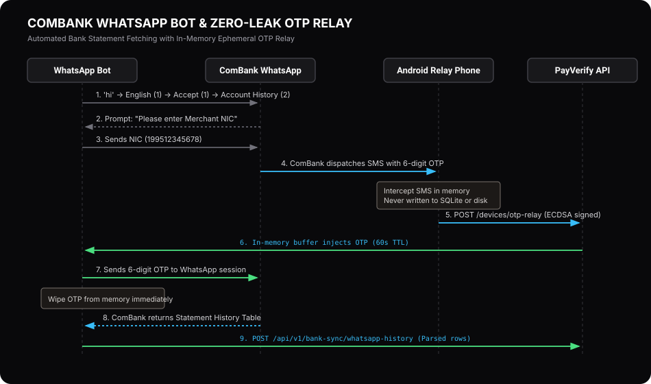
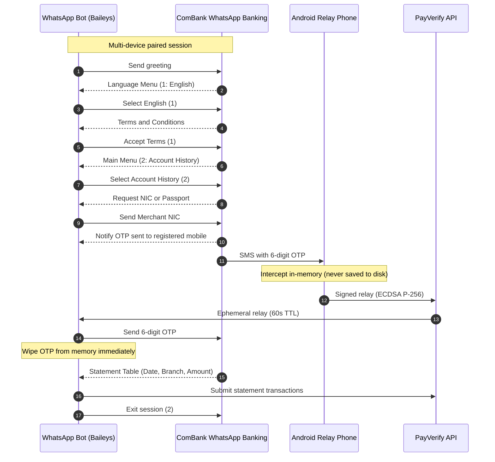

# PayVerify ComBank WhatsApp Banking Bot

The **`payverify-whatsapp-bot`** is an automated daemon built with TypeScript and [`@whiskeysockets/baileys`](https://github.com/WhiskeySockets/Baileys) that synchronizes bank statements with the **Commercial Bank of Ceylon (ComBank)** official WhatsApp Banking service (`+94 77 123 4567`).

---

## Architectural Workflow & OTP Relay Sequence



### Relay Workflow (Universal Text Rendering)

```text
1. WhatsApp Bot sends greeting "hi" to ComBank WhatsApp (+94 77 123 4567)
   │
2. Navigates menu: English (1) -> Accept T&C (1) -> Account History (2)
   │
3. Enters Merchant NIC / Passport number (e.g. 199512345678)
   │
4. ComBank dispatches SMS with 6-digit OTP to merchant phone
   │
5. Android Relay intercepts SMS in-memory (never saved to SQLite or disk)
   │
6. Phone relays OTP to PayVerify API via signed request (ECDSA P-256)
   │
7. API forwards OTP to bot's in-memory buffer (60-second TTL)
   │
8. Bot sends 6-digit OTP into WhatsApp session and wipes memory immediately
   │
9. ComBank returns statement history table (Date, CRM Branch, LKR Amount)
   │
10. Bot parses rows via regex and submits to /api/v1/bank-sync/whatsapp-history
```

<details>
<summary>View Mermaid Source Specification</summary>



</details>

---

## Pairing Methods

### 1. 8-Digit Pairing Code (Camera-Free)
Link the bot directly to your merchant WhatsApp account without scanning a QR code with a phone camera:
1. Open **Web Admin Dashboard > WhatsApp Sync**.
2. Enter your ComBank registered WhatsApp mobile number (e.g. `94771234567`).
3. Click **Get Pairing Code**.
4. In WhatsApp on your phone: go to **Linked Devices > Link a Device > Link with phone number instead**, and enter the 8-digit code.

### 2. Multi-Device QR Code
Alternatively, open the WhatsApp Sync screen to view and scan the live multi-device QR code.

---

## Daemon API Endpoints (Port 3100)

All state-changing endpoints are protected by `PV_BOT_SECRET` via header `X-Bot-Secret` or `Authorization: Bearer <token>`.

### 1. `GET /status`
Returns connection status, active conversational state (`IDLE`, `AWAITING_OTP`, `FETCHING_STATEMENT`), and last sync timestamp.

### 2. `GET /qr`
Returns the raw multi-device pairing QR code string and rendered base64 data URL.

### 3. `POST /pairing-code`
Requests an 8-digit pairing code for camera-free phone linking.
- **Request Body**: `{ "phoneNumber": "94771234567" }`
- **Response**: `{ "success": true, "code": "ABCD-1234", "phoneNumber": "94771234567" }`

### 4. `POST /sync` or `POST /sync-on-demand`
Triggers an immediate ComBank statement fetch conversation.

### 5. `POST /otp`
Receives an ephemeral OTP code from the PayVerify API to inject into an active ComBank session.
- **Request Body**: `{ "otp": "492817" }`
- **Response**: `{ "success": true, "message": "OTP received and injected" }`

---

## Environment Variables (`.env`)

```bash
PORT=3100
WHATSAPP_AUTH_DIR=/data/auth
PV_COMBANK_WHATSAPP_NUMBER=94771234567
PV_COMBANK_NIC=199512345678
PV_API_URL=http://localhost:8000
PV_BOT_SECRET=your_shared_bot_secret
SYNC_INTERVAL_MINUTES=15
```

---

## Testing & Quality Assurance

```bash
# Install dependencies
npm install

# Run ComBank statement regex parser tests
npx tsx --test src/parser.test.ts

# Type check TypeScript code
npx tsc --noEmit

# Start daemon
npm start
```
